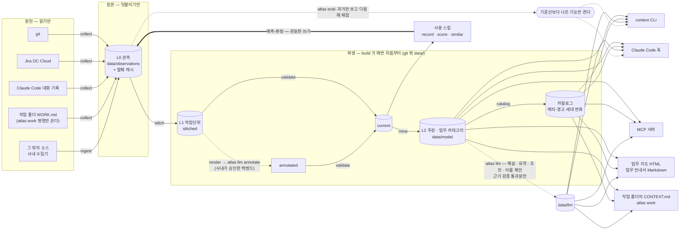
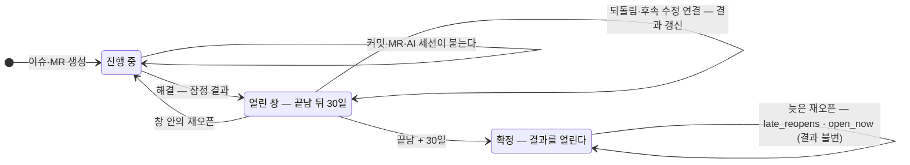
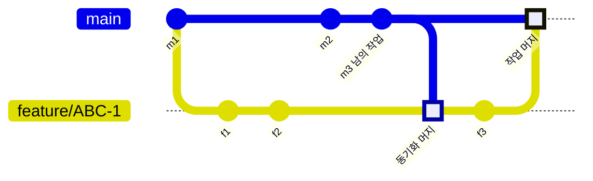

# 엔진 구조

> 왜 이렇게 생겼는지(원칙)는 `METHODOLOGY.md`, 데이터 계약은 `method/schema.md`, 효용의 실측은 `EVALUATION.md`.
> 여기는 엔진(`atlas/`)이 무엇을 어떤 순서로 만들고, 어디에 두고, 어디를 넓히면 되는지를 적는다.
> 용어(관측 · 작업단위 · 주장 · 고아 · 열린 창 · 동기화 머지 …)는 [`CONCEPTS.md`](CONCEPTS.md#용어집). 작업 폴더의 형식과 이유는 [`WORKSPACE.md`](WORKSPACE.md). 업무 카테고리 · 채널 · LLM 작업의 쓰임은 [`CHANNELS.md`](CHANNELS.md).

## 한눈에

`python -m atlas build` 가 stitch 부터 report(업무 지도 · 안내서)까지를 매번 처음부터 다시 만든다. `[llm] auto` 에 적은 작업은 백엔드가 있을 때 catalog 와 report 사이에 돈다(예산 · 캐시 안에서, 실패해도 빌드는 계속). 수집은 `atlas collect all`(또는 `build --collect`).

## 두 층의 지식

| 층 | 무엇 | 언제부터 | 사람·LLM 비용 |
|---|---|---|---|
| **결정론 마이닝** | 함께 바뀌는 파일 · 결함이 몰린 파일 · 처리 통계 · 실천과 결과 · 비슷한 과거 작업 · **업무 카테고리**(흐름 · 순서 · 관계 · 참조점 · 접점) | 수집한 날부터 | 없음 (카테고리 정의는 사람이 다듬는다) |
| **의미 (원형·어휘)** | 일의 모양(원형) · 함정 · 숨은 하위작업 · 처리 수와 결과 | 첫 도출(BOOTSTRAP A3) 뒤 | LLM 주석 + 사람 판정 |

- 마이닝 층은 라벨 없이 첫날부터 쓸모가 있고, 그 쓸모를 시간 분할로 잴 수 있다(EVALUATION.md).
- 의미 층은 "어떤 종류의 일인가·어떻게 처리했나"를 다룬다. 마이닝이 못 하는 일이다.
- 두 층은 같은 작업단위(WU)와 같은 소비 경로를 쓴다.
- 엔진은 의미 층의 계약과 실행을 함께 제공한다: 입력 문서 · 주석 실행(`atlas llm run annotate`) · 사후 검증 · 기록 · 채점 · 유사 사례. 사내에 남는 것은 **어느 LLM 에 보내도 되는가**(백엔드 승인과 자격 증명)뿐이다.
- LLM 은 두 층 모두에서 말만 한다 — 수치는 계산이 내고(해설은 사실 id 자리표시), 문장마다 근거를 검증한다(`CHANNELS.md` §3).

## 모듈

| 모듈 | 하는 일 | 입력 → 출력 |
|---|---|---|
| `config` | `atlas.toml` + 기본값, 키·결함·역할 패턴 | → 설정 |
| `collect/git` | 커밋·머지 → `vcs.commit`·`vcs.merge`. 키·경로·이름 바뀜·MR·되돌림, 증분 | git → L0 |
| `collect/jira` | DC v2·Cloud v3. 생성 당시 라벨 복원, 상태·해결·변경·연결·댓글. 재시도·증분 | REST → L0 |
| `collect/claude_code` | 세션 요약 → `ai_session.session`. 편집 파일(그 파일의 저장소 기준)·테스트 실행·커밋·오류·압축·세션을 연 작업 폴더 | `~/.claude/projects` → L0 |
| `collect/workspace` | 작업 폴더 → `workspace.snapshot`. front-matter·파일 역할별 개수·작업 기록 발췌. 비밀값 파일·생성물·버릴 것은 관측하지 않는다 | 작업 공간 루트 → L0 |
| `collect/sdk` | 사내 수집기 도구 `Kit` — 역할 판정 · 결정론 키 · 발췌만 · 그릇 이름 해시(선택 HMAC) · 결정론 obs_id. 골격은 `method/recipes/collector_template.py` | 사내 소스 → JSONL |
| `ingest` | 외부 수집기 JSONL 검증 후 덧붙임. `--dry-run` 은 연결 미리보기(아는 이슈 키 · 단서 없음 비율) | JSONL → L0 |
| `store` | 검증·중복 제거·월별 덧붙이기·발췌 캐시·증분 상태 | — |
| `stitch` | 객체 중심 상관, 사후 신호, 결과 계산, as_of 재생 | L0 → `stitched.jsonl` + 보고 |
| `render` · `validate` | LLM 입력 문서 · 주석 사후 검증 (R1~R4) | L1 → 문서 · `current.jsonl` |
| `mine/*` | corpus(경로 정규화) → cochange · hotspot · process · practice · moves · text · **category** | current + L0 → `data/model/` |
| `taxonomy` | 업무 카테고리 정의(`method/categories.yaml`) 읽기 · 모양 검사 · 작업단위를 영역 사슬과 국면에 놓기 · 접점·참조점 물려주기 | 정의 + WU 사실 → 배치 |
| `catalog` | 소스 신선도·커버리지·고아·세대 변화·AI 세션 메타 → 경고와 권하는 조치 | 전부 → `catalog.json` |
| `context` · `hook` · `mcp_server` · `report` · `guide` | 소비 — Claude 용 맥락(카테고리 줄 포함), 편집·프롬프트 순간 주입, MCP, 사람용 HTML(업무 지도), 카테고리별 Markdown(안내서). 맥락 · 훅 · MCP 는 낸 제안을 쓰임 기록에 남긴다 | `data/model` → 출력 |
| `catview` · `diagram` | 채널들이 같은 말을 하게 하는 카테고리 읽기(요약 · 다음 단계 · 병목 · 접점) · 결정론 그림(SVG · Mermaid) | `categories.json` → 글 · 그림 |
| `llm/` | LLM 작업 — `check`(근거 · 자리표시 · 숫자 · 크기 낱말 · 표기) · `backends`(none · claude(bare · safe-mode) · command) · `tasks`(해설 · 주석 · 주간 요약 · 초안 · 이름 제안 · 조사 맞춤) · `runner`(캐시 · 장부 · 예산 · 잠금 · 안정성) · `bench`(실측) | 모델 · 입력 문서 → `data/llm/` · `annotated.jsonl` · 리포트 · 수신함 |
| `doctor` | 설정 · 방법 · 데이터 · 소비 · LLM · 마지막 수확 점검. `--online` 은 Jira(서버 정보 → 자격 증명) · claude 격리까지. 아무것도 바꾸지 않는다 | 전부 → 화면 |
| `init` | git 기록(커밋 제목 · 브랜치 · user.email/name · 원격 기본 브랜치)과 Claude Code 기록 폴더 이름에서 `atlas.toml` 초안. 덮어쓰지 않는다 | 저장소 → 설정 초안 |
| `harvest` (`atlas harvest` · `atlas schedule`) | 주간 수확 — 수집 → 보존 기한 → 빌드(LLM auto) → 채점 → 리포트, 단계마다 실패를 잡고 상태 파일은 언제나. 정기 실행 설정(Windows 작업 스케줄러 · launchd · cron)을 출력만 | 전부 → 수확 리포트 · `harvest-last.json` |
| `retention` | 보존 기한 집행 — 발췌 캐시(시스템별) · LLM 답 캐시 · 리포트. 관측은 지우지 않는다. 낡게 될 주석 수를 센다 | `[retention]` → 지운 수 |
| `usage` (`atlas usage`) | 훅 · 맥락의 제안 기록과 결과 맞춤 — 반영률 · 정밀도 · 재현율, 보류군 차이(세션 군집 부트스트랩) | `data/usage/` + L0 · L1 → 지표 |
| `record` · `score` · `similar` | 예측·판정·LLM 출력 판정 기록(유일한 사람 쓰기 경로), 채점, 원형 기준 유사 사례 | L0·current |
| `workspace` (`atlas work`) | 작업 폴더 규칙(무엇이 작업인가 · 파일 역할 · 작업 기록 읽기) · 새 작업 · CONTEXT.md · 종료 · 위생 목록. 사람이 부를 때만 작업 폴더에 쓴다 | 작업 공간 ↔ `data/model` |
| `evaluate` | 시간 분할 효용 평가(기준선·부트스트랩) | L0 → 평가 JSON |
| `pipeline` | build 순서·시간 기록·주석 이어 붙이기 | — |
| `check` · `schema_gen` | 커밋 전 무결성 · 코드북 → 주석 스키마 | — |

## 파일

| 경로 | 만드는 것 | 읽는 것 | git |
|---|---|---|---|
| `data/observations/YYYY-MM.jsonl` | collect · ingest · record | 전부 | 밖 |
| `data/excerpts.jsonl` | 수집기(가린 뒤 자른 본문) | stitch · mine · render | 밖 |
| `data/state/` | 수집 증분 · 훅 세션 기록 · 훅 오류 로그 · 수확 상태 · 로그 · 잠금 | 수집기 · 훅 · harvest · doctor | 밖 |
| `data/usage/<연-월>.jsonl` | 훅 · 맥락 · MCP (관측이 아니다 — 세대 id 와 무관) | usage · harvest | 밖 |
| `data/units/{stitched,annotated,current}.jsonl` · `stitch_report.json` | stitch · `atlas llm run annotate` · validate | mine · score · similar · context | 밖 |
| `data/model/claims.jsonl` · `paths.json` · `text_index.json` · `categories.json` · `generation.json` · `catalog.json` · `build.json` · `history/` | mine · catalog · build | context · hook · MCP · report · guide · llm | 밖 |
| `data/reports/atlas-<세대>.html` · `guides/` · `<주>-digest.md` · `<날짜>-harvest.md` · `llm-bench-<시각>.md` | report · guide · llm · harvest · bench | 사람 | 밖 |
| `data/llm/` (캐시 · `ledger.jsonl` · `category_card.json`) | `atlas llm` | report · guide · MCP · catalog | 밖 |
| `method/categories.yaml` · `method/prompts/*.md` | 사람 | mine(세대 id 의 입력) · llm(내용 해시가 캐시 키) | 안 |
| 작업 폴더의 `WORK.draft.md` | `atlas llm run work_draft --write` | 사람 | 사람의 폴더 — 수집하지 않는다 |
| 작업 폴더의 `CONTEXT.md` | `atlas work new · context` | Claude(`@CONTEXT.md`) · 사람 | 사람의 폴더 — 수집하지 않는다 |
| `out/` · `reports/` | 사내 카드 레시피(원형 단위 집계) | 사용 스킬 | 안 |

`data/model/` 이 git 밖인 이유: 주장의 근거에 작업단위·커밋 id 가 있다. WU 단위 귀속은 git 에 남기지 않는다(METHODOLOGY.md §11).

## 작업단위의 수명 — 결과는 언제 정해지나

- 결과는 끝난 순간이 아니라 열린 창(`policy.open_window_days`, 기본 30일)이 지난 뒤 확정한다. 창 안의 재오픈·되돌림·사람이 남긴 후속 수정 연결이 결과를 바꾼다. 연결 신호의 시각은 연결이 처음 관측된 때와 후속 이슈가 시작된 때 중 늦은 쪽이다.
- 확정되면 이슈 상태를 얼린다. 늦은 재오픈은 `late_reopens` 로 세기만 하고, 지금 열려 있으면(`open_now`) 맥락이 "확정 뒤 다시 열려 지금 진행 중"이라고 따로 알린다. 실데이터 예: LANG-1291.
- 결과의 우선순위는 `rolled_back` > `followup_fix` > `reopened` > `abandoned` > `clean` 이다. 파일 수준 SZZ 근사는 결과에 쓰지 않는다(`followup_suspected`).
- 계약은 `method/schema.md` 의 L1 규칙.

## 동기화 머지 — 들인 커밋은 누구의 작업인가

- **작업 머지**의 둘째 부모(f3)는 기능 브랜치 위에 있다. 들인 커밋 f1~f3 이 ABC-1 의 작업이다.
- **동기화 머지**는 메인라인(m3)을 기능 브랜치로 들인다. m3 은 남의 작업이라 ABC-1 에 넣지 않는다.
- 판정은 두 겹이고 결과는 관측의 `sync_merge` 로 남는다. 먼저 머지 메시지로 본다.

  | 머지 메시지 | 판정 |
  |---|---|
  | "Merge branch 'main' into feature/X" — 들여온 브랜치가 메인라인 | 동기화 |
  | GitHub "Merge pull request #12 from acme/develop" — acme 가 이 저장소의 소유자 | 동기화 (릴리스 PR) |
  | 위와 같은 PR 인데 포크에서 왔거나 소유자를 모름 | 작업 |
  | "Merge branch 'main' into 'main'" + MR 번호 — 포크의 main 을 같은 이름으로 들인 MR | 작업 |
  | "Merge commit '…' into feature/X" · "Merge tag …" — MR 이 아니고 기능 브랜치로 들임 | 동기화 |
  | 그 밖의 형식 | 아래 구조 판정으로 |

  소유자는 소스 설정 `owner`, 없으면 원격 `upstream` → 수집하는 ref 의 원격 → `origin` 순으로 읽는다.
- 메시지로 가리지 못하면 구조로 본다. 머지의 둘째 부모가 수집하는 ref 의 첫 부모 사슬 위에 있으면 메인라인을 끌어온 것이므로 동기화다. 메시지 형식과 무관하다.
- 메시지 형식은 GitHub · GitLab · Bitbucket · 사내 도구마다 달라, 독립 검토마다 새 구멍이 나왔다. 구조 판정이 그 부류를 형식과 무관하게 막는다.
- 둘 다 아니면 작업으로 센다. 애매할 때 남의 커밋이 섞이는 쪽이 내 커밋을 잃는 쪽보다 낫기 때문이다.

## 설계 결정 — 무엇을, 왜

| 결정 | 이유 | 근거 |
|---|---|---|
| **WU 는 이슈 단위, 관측은 여러 WU 에 속할 수 있다**(다대다). 키가 3개를 넘는 커밋은 잇지 않는다 | 합집합으로 묶으면 여러 키를 단 커밋이 이슈들을 사슬처럼 이어 거대한 덩어리를 만든다. 객체 중심 로그의 원칙이기도 하다 | van der Aalst 2019a · OCEL |
| **동기화 머지**(메인라인을 들여오는 머지)는 들여온 커밋을 쓰지 않는다. 메시지와 구조 두 겹으로 판정한다(위 절) | 쓰면 메인라인의 남의 커밋이 그 이슈의 작업단위로 들어간다("Merge branch 'develop' into feature/X" 는 흔하다). 모를 때는 진짜 작업을 버리지 않는 쪽으로 | LANG 에서 43·36 커밋짜리 가짜 묶음이 사라짐(독립 검토) · 테스트 `test_sync_message_forms` · `test_collector_marks_sync_structurally_and_lists_unknown_work` |
| **브랜치 이름은 해시로만 남긴다**(기본). 트레일러(Signed-off-by 등)의 이름은 발췌에서 뺀다 | jdoe/PROJ-1·owner:patch-1 처럼 이름에 계정이 들어가는 관례가 흔하고, L0 는 나중에 지울 수 없다. 조인은 같은 규칙의 해시로 된다 | — |
| **as_of 이후는 보지 않는다.** 세대 id = 관측 id·설정·레시피 버전의 해시 | 같은 입력이면 같은 결과다. 시간 분할 평가와 재빌드 비교가 여기에 기댄다. 레시피의 의미가 바뀌면 버전을 올려 옛 세대와 섞이지 않게 한다 | 테스트 `test_deterministic` · `test_as_of_hides_future` · `test_generation_id_covers_stitch_recipe` |
| **이슈 라벨은 생성 당시 값으로 되감는다.** 이후 변경은 사건으로 남긴다 | 지금 값을 생성 시각에 붙이면 미래가 샌다 | LANG 에서 유형이 바뀐 이슈 45건 |
| **설정에 기대는 판정은 빌드 때 다시 한다**: 결함 수정 여부, 키 거르기 | L0 는 덧붙이기만 하고 obs_id 로 중복을 거른다. 수집 때 판정을 박아 두면 규칙을 고쳐도 영영 옛 값이 남는다 | — |
| **커밋의 결함 수정 여부는 이어진 이슈의 유형이 정한다.** 이슈가 없을 때만 메시지 패턴 | "Applying X's patch" 같은 메시지가 Improvement 이슈의 커밋을 결함 수정으로 셌다 | LANG 143건·ZK 248건이 잘못 세어짐(독립 검토) |
| **결과는 열린 창 안의 사후 사건으로만 정한다** — 확정되면 얼리고, 지금 상태는 따로 보여 준다(위 절) | 창 밖의 되돌림·연결·재오픈까지 세면 "확정"이 확정이 아니고, 오래된 WU 일수록 문제율이 높아 보인다. 늦은 재오픈이 종료 시각을 옮기거나 늦게 단 연결이 옛 날짜로 들어와도 같은 일이 생긴다 | 테스트 `test_settled_outcome_is_final` · `test_late_link_and_late_reopen_do_not_change_settled_outcome` |
| **장부 파일을 마이닝·귀속에서 뺀다** (`mining.ignore_paths`) | 거의 모든 커밋에 따라 바뀌어 추천을 독차지하고 귀속을 오염시킨다 | LANG changes.xml 17% · pom.xml 8% |
| **SZZ 근사는 `followup_suspected` 로 분리한다** | 파일 수준 근사의 표본 정밀도가 약 25%다. 결정론 신호의 자격이 없다 | EVALUATION.md 결과 5 |
| **맥락은 혼합, 훅은 엄격** | 혼합(규칙 → 이름 짝 → 같은 디렉터리)은 재현율이 가장 높다. 편집 순간에는 정밀도(신뢰도 ≥ 0.5)를 우선한다 | EVALUATION.md 결과 1 |
| **핫스팟 순위 기본값은 결함 수정 수** | 두 저장소 모두 상위 20 정밀도가 가장 높고 "결함 수정 N건"으로 읽힌다. 포착률이 가장 높은 기준은 저장소마다 달라 `atlas eval` 로 고른다 | EVALUATION.md 결과 2 |
| **소요 시간은 예측하지 않는다** | 비슷한 작업 기반 추정이 기준선보다 낫지 않았다. 분포(처리 통계)만 보여 준다 | EVALUATION.md 결과 4 |
| **AI 세션·작업 폴더는 마지막 관측만 쓴다** | 둘 다 이어 쓰이며 바뀐다. obs_id 에 줄 수(세션)·상태 해시(작업 폴더)를 넣어 덧붙이기만 하고, 읽을 때 최신을 고른다. 작업 폴더는 가장 나중에 수집한 것이 최신이다 — 가장 늦게 바뀐 파일을 지우면 수정 시각이 거꾸로 간다. 예전 상태로 되돌아가면 직전 관측을 해시에 더해 새로 남긴다(그러지 않으면 옛 obs_id 와 겹쳐 버려진다). 과거 시점으로 다시 계산할 때는 그때까지 **수집한** 것만 본다 — 옮겨 온 파일은 수정 시각이 옛날이라 수정 시각으로 거르면 미래가 샌다 | 테스트 `test_latest_snapshot_only` · `test_reverted_state_becomes_a_new_observation` · `test_as_of_hides_later_collections_and_future_closing` |
| **작업 폴더는 파일로 관리한다 — 정체·상태는 작업 기록에, 위치는 자유** | Claude Code 는 세션을 시작 폴더에 묶어 저장하고 `--continue` 도 그 폴더 기준이다. 상태를 위치로 나타내면(done/ 으로 이동) 이어 쓰기와 atlas 의 세션→작업 연결이 끊긴다. 폴더 분류 체계는 사람마다 달라 강요하면 지켜지지 않는다 | `[문서]` sessions · `WORKSPACE.md` |
| **트래커가 있으면 트래커가 기간·상태의 정본, 없을 때만 작업 기록** | 필드별 신뢰 소스(METHODOLOGY.md §10) — 상태는 트래커다. 작업 기록은 늦게 고쳐지기 쉽다. 둘이 어긋나면 고치지 않고 위생 경고로 알린다 | 테스트 `test_keyed_work_joins_issue_and_tracker_stays_canonical` |
| **atlas 가 만든 CONTEXT.md 는 수집하지 않는다** | 요약의 요약 금지(N3). 출력이 다음 빌드의 입력이 되면 스스로를 강화한다. 첫 줄의 생성물 표시로 가린다 — 표시가 없으면 사람의 파일이다 | 테스트 `test_obs_id_follows_content_not_mtime` |
| **세션의 편집 경로: 저장소에서 연 세션은 그 저장소 파일만, 작업 폴더에서 연 세션은 파일마다 그 파일의 저장소 기준, 작업 공간 안의 파일은 코드가 아니다** | 세션 경로에는 저장소 구분이 없다. 저장소 세션이 남의 저장소 파일(pom.xml 등)을 남기면 엉뚱한 커밋과 겹친다 — 그래서 예전과 같이 둔다. 작업 폴더에는 코드가 없으니 `--add-dir` 로 고친 저장소 파일을 그 저장소 기준으로 남긴다(예전에는 버려졌다). WORK.md 를 저장소 경로로 남기면 경로 겹침이 엉뚱하게 붙는다. 단 작업 폴더 안에 받아 둔 저장소 사본의 파일은 코드다 | 테스트 `test_session_carries_work_id_and_separates_work_edits` · `test_clone_inside_a_work_folder_is_code` · `test_repo_session_keeps_other_repos_out` |
| **작업 폴더 id 가 겹치면 경로로 가른다** | 폴더를 복사해 새 일을 시작하면 front-matter `id` 가 같아져 두 일이 한 작업으로 합쳐진다. 그 이름의 폴더 하나만 id 를 쓰고 나머지는 경로를 쓴다. 수집기·세션·맥락·명령이 같은 규칙(`workspace.work_ids`)을 쓴다 | 테스트 `test_copied_folder_keeps_its_own_identity` |
| **작업 폴더 위생 경고는 맥락 첫 줄에 넣지 않는다** (`area: workspace`) | 맥락 첫 줄은 "이 지식을 얼마나 믿을지"다. 정리 문제는 카탈로그와 `atlas work status` 에서 본다 | 테스트 `test_context_for_a_work_folder` |
| **카테고리 정의 · LLM 운영 경고도 맥락 첫 줄에 넣지 않는다** (`area: category` · `llm`) | 같은 이유 — 미분류 비율이나 LLM 통과율은 지금 이 일의 지식을 믿을지와 무관하다. 카탈로그에서 본다 | 테스트 `test_llm_and_category_warnings_stay_out_of_the_context` |
| **사후 결과는 이슈 WU 에서만 센다** (처리 통계·실천) | MR·세션 WU 에는 재오픈을 관측할 길이 없다. "문제 없음"이 "관측 못 함"과 섞인다 | — |
| **모델 파일에 형식 버전을 둔다** | 구조가 바뀐 뒤 옛 파일을 조용히 잘못 읽으면 훅이 말없이 아무것도 안 한다. 맞지 않으면 '다시 빌드'라고 말한다 | 이 구현 중 실제로 겪었다 |
| **훅은 막지 않는다.** 어떤 오류·종료에도 출력 없이 0, 인스턴스가 아닌 루트에는 아무것도 쓰지 않는다. 세션·파일마다 한 번만 말하고 1,500자로 자른다 | 작업 흐름을 방해하면 끈다 | 테스트 `test_hook_never_blocks` |
| **훅의 입출력은 UTF-8 바이트**, 명령은 셸 문법(환경 변수 접두)에 기대지 않고 경로를 인자로 넘긴다 | Windows 의 파이프는 시스템 코드 페이지(cp949)라 한글 프롬프트에서 훅이 조용히 죽었다. 같은 설정이 Windows·macOS·Linux 에서 돌아야 한다 | cp949 재현(독립 검토) · 테스트 `test_hook_reads_and_writes_utf8_bytes` |
| **평가의 신뢰구간은 군집 부트스트랩** (동반 변경은 커밋, 핫스팟은 파일) | 같은 커밋의 질의, 같은 파일의 접촉은 독립이 아니라 질의 단위로 뽑으면 구간이 좁아진다 | 유의 시점 수가 일부 줄었다 — EVALUATION.md |
| **업무 카테고리의 축은 사람이 정하고(`categories.yaml`), 놓는 것은 계산이다.** 기본은 트래커 컴포넌트 → 유형, 이름의 구분자로 상하위 | 트래커 분류는 이미 팀이 쓰는 말이라 첫날부터 읽힌다. 원형(의미 층)은 그 위에서 따로 창발한다. 정의 파일은 세대 id 의 입력이고, 모양이 틀리면 빌드가 멈춘다 — 조용히 미분류가 되지 않게 | 테스트 `test_bad_definitions_are_reported_not_silently_misread` |
| **카테고리 흐름은 끝난 일의 해결까지, 최근 730일(모자라면 최근 30건)** | 열린 일은 흐름이 덜 끝나 "생성 → 끝"으로 보이고(ZK 에서 흐름의 30%), 해결 뒤 정리(릴리스 때의 Closed, 중앙 80일)는 병목처럼 보인다. 둘은 따로 센다. 워크플로가 바뀌면 옛 흐름이 섞이지 않게 최근으로, 몇 건으로 그린 흐름이 우연에 휘둘리지 않게 최소 표본을 둔다 | ZK · LANG 실측 · 테스트 `test_flow_ends_at_resolution_and_marks_rework` |
| **가장 흔한 길은 실제 변형이다** — 굵은 이음을 이어 붙이지 않는다 | 이음마다 지나는 일이 달라, 이어 붙인 길은 아무도 따르지 않은 길일 수 있다(ZK 108개 흐름 중 4개, 0건 지지) | 독립 검토 · 테스트 `test_main_path_is_a_real_variant_and_reaches_end` |
| **LLM 은 말만 한다 — 해설의 수치는 사실 id 자리표시, 보여 줄 때 지금 값** | 숫자를 LLM 이 쓰면 지어내거나 낡는다. 자리표시면 매주 빌드해도 맞고, 카드는 모양(흐름 · 병목 · 관련 · 사례 · 수치 구간)이 바뀔 때만 다시 쓴다(비용). 숫자 낱말 · 링크 · 근거 없는 문장은 버린다 | 시연에서 "재오픈 3%"(실제 4%) 문장이 걸렸다 · `tests/test_llm.py` |
| **LLM 백엔드는 기본 none, 대화 세션도 백엔드다** (prompt · import) | 사내 데이터를 보낼 곳은 사내가 정한다(CLAUDE.md 규칙 8). 승인 전에도 같은 검증을 거쳐 쓸 수 있어야 한다. claude 백엔드는 도구 없음 · 빈 임시 폴더에 더해 `--bare`(API 키) 또는 `--safe-mode`(로그인 인증)로 사용자 CLAUDE.md · 훅 · 스킬이 입력에 끼지 않게 하고, 하위 프로세스에 `ATLAS_LLM_CALL` 을 둬 atlas 훅이 스스로 비킨다 | 실측 CLI 2.1.299(`--help` · 호출) · 테스트 `test_claude_backend_is_hermetic_and_cards_render_current_numbers` · `test_hook_stays_out_of_llm_calls` |
| **해설 검증은 '금지'가 아니라 '대조'다** — 크기 낱말은 인용한 비율 사실의 구간과, 수 + 명사는 인용한 근거의 수와 맞춘다 | v2.2 처럼 크기 낱말을 모두 막으면 사람이 읽기 좋은 문장이 버려지고(실측 ZK 8장 중 7장에서 문장을 버림), 다 풀면 지어낸 크기가 샌다. 대조면 둘 다 된다 — 손질 뒤 문장을 버린 답 7 → 2, 남은 버림은 옳게 막은 것 | 공개 데이터 실측(CHANNELS.md §3.7) · 테스트 `tests/test_llm.py` |
| **무인 수확은 한 명령이고 단계마다 실패를 잡는다 — 상태 파일은 언제나 쓴다** | 스케줄러는 종료 코드만 본다. 소스 하나 · 단계 하나의 실패가 전체를 멈추면 나머지까지 낡고, 상태를 못 남기면 실패한 줄도 모른다 | 테스트 `test_a_broken_step_still_writes_the_report_and_last_state` |
| **쓰임은 관측이 아니다 · 보류군은 세션 단위다** | 제안 기록을 L0 에 넣으면 세대 id 가 매번 바뀌고 해석이 정본에 들어간다. 한 세션 안에서 알림과 보류가 섞이면 알린 후보가 보류한 쪽 행동에 번진다 — 배정 단위와 구간의 군집 단위를 같게 | 독립 검토 · 테스트 `TestUsage` |
| **CI 는 Windows 에서도 돈다 · 경로는 실제 경로로 견준다** (`common.relative_inside`) | 사내 PC 는 Windows 가 많다. Linux 에서만 시험하면 8.3 짧은 이름(RUNNER~1) · 드라이브 없는 절대 경로 · `\` 구분자 · 콘솔 코드 페이지가 숨는다 | CI windows-latest 첫 실행에서 6건 실패 → 수정 · 테스트 `TestPortablePaths` |
| **사내망 오류는 다시 시도하지 않고 원인과 할 일을 말한다** (인증서 · 이름 · 프록시 인증 · HTML 응답 · 3.13 엄격 검사) | 이런 오류는 다시 해도 같다(예전엔 1분 넘게 재시도한 뒤 실패). Python 3.13 은 규격을 다 지키지 않는 옛 사내 CA 를 거절한다 — `tls_strict = false` 는 그 검사만 끈다 | 실측: 로컬 사설 CA 로 3.13 거절 · `tls_strict = false` 통과 · 3.11 통과 · 테스트 `TestCorporateNetwork` |
| **LLM 예산은 보수적으로 센다** — 비용을 모르면 호출당 상한, 반복 오류는 물러선다, 실행은 하나씩 | 백엔드가 비용을 알려 주지 않으면 상한이 의미 없어진다. 오류는 캐시하지 않으니 매 빌드 다시 돈을 쓴다 | 독립 검토 · 테스트 `test_unknown_cost_is_charged_as_the_per_call_cap` |
| **MCP 는 읽기 전용이다.** `ingest` 는 사람·사용 사건(atlas·self_report)을 받지 않는다 | 사람 쓰기 경로는 `record` 하나다(METHODOLOGY 원칙 P7). 그래야 트리아지 없는 판정 같은 것이 들어오지 않는다. SDK 1.x(FastMCP)·2.x(MCPServer) 둘 다 받는다 | 실측: mcp 1.30 · 2.2 |
| **수집기는 자격 증명을 같은 호스트의 https 에만 보낸다.** 리다이렉트가 다른 호스트나 http 로 가면 떼고, 설정이 https 가 아니면 처음부터 보내지 않는다 | urllib 은 리다이렉트에 Authorization 을 그대로 실어 보낸다 — SSO·프록시로 새지 않게 | 테스트 `test_jira_redirect_strips_auth_and_requires_https` |

## 넓히는 곳

- **새 소스**: 관측 계약에 맞는 JSONL 을 내는 수집기를 어떤 언어로든 만들어 `atlas ingest` 로 넣는다. 결정론 obs_id 가 필수다.
  - 파이썬이면 `method/recipes/collector_template.py` 를 복사해 `fetch` · `to_events` 만 고친다 — `atlas.collect.sdk.Kit` 이 역할 · 키 · 발췌 · 해시를 지킨다(`method/schema.md` "사내 수집기가 내는 사건").
  - 엔진 안에 넣으려면 `atlas/collect/<이름>.py` 에 `add_args` · `source_from_args` · `collect` 를 두고 `collect/__init__.py` 의 표에 더한다.
- **주석(LLM)**: `atlas llm run annotate` 가 한다(백엔드는 `[llm]`). 다른 도구로 하려면 `data/render/` 문서를 읽어 `annotation.schema.json` 형식으로 주석하고 `data/units/annotated.jsonl` 에 쓴다.
  - 각 WU 의 `build.input_hash` 에 문서 해시를 넣는다.
  - 다음 build 가 해시가 같은 주석만 이어 붙이고, 바뀐 것은 다시 주석할 것으로 센다.
- **새 LLM 작업**: `atlas/llm/tasks.py` 에 `Task`(입력 · 스키마 · 검증 · 둘 곳)를 더하고 `method/prompts/<작업>.md` 를 쓴다. 문장마다 근거, 숫자는 자리표시나 인용한 근거의 것만 — `llm/check.py` 를 그대로 쓴다.
- **새 채널**: `catview` 로 읽고 `diagram` 으로 그린다 — 같은 수치를 같은 말로.
- **새 마이너**: `mine/claims.make` 로 주장을 만들고 `mine.run` 에 더한다. 강도 정의를 그 모듈 문서에 적는다.
  - 효용을 주장하려면 `evaluate` 에 과제를 더한다.

## 성능 (실측, 2026-10-13, 이 개발 환경, 벽시계 — 파이썬 시작 포함)

| | LANG (관측 28,074) | ZK (관측 76,327) |
|---|---|---|
| 첫 전수 수집 (git + Jira) | 58초 (git 단독 16초) | 3분 8초 |
| `build` (stitch → report · 안내서, 카테고리 포함) | 8초 | 21초 |
| ↳ 그중 카테고리 모델 (계산만) | 0.9초 (66개) | 1.9초 (126개) |
| `context` 한 번 (이슈 + 파일) | 0.4초 | 0.9초 |
| 훅 한 번 (파일 편집) | 0.2~0.3초 | 0.2~0.3초 |
| `eval` 시점 하나 (4과제, 5개 시점 평균, 2회) | 9~10초 | 17초 |

## 남겨 둔 시드 — 아직 켜지 않은 것

| 시드 | 켤 때 | 왜 아직 아닌가 |
|---|---|---|
| 줄 수준 SZZ (결함 수정 커밋의 지운 줄을 `git blame`) | 사후 귀속을 결정론 신호로 쓰고 싶을 때 | 수집 비용이 크다. 줄 수준에서도 정밀도가 보장되지 않는다(Herzig & Zeller 2013) |
| 키 없는 커밋 군집 (시간·경로) | 고아 비율이 높고 키 습관을 바꿀 수 없을 때 | 휴리스틱 WU 가 통계를 흐린다. 먼저 키 습관을 권한다(카탈로그 제안) |
| Stop 훅: 세션 끝에 높은 신뢰도 짝을 안 바꿨으면 상기 | 훅 힌트가 행동을 바꾸는 것을 보류군(`atlas usage`)으로 확인한 뒤 | 잔소리가 되기 쉽다 |
| 이슈 맥락의 '바꿀 파일' 줄에도 보류군 | 훅 보류군이 효과를 보인 뒤, 맥락 쪽 효과도 따로 알고 싶을 때 | 맥락은 일을 받을 때 한 번이라 표본이 작고, 숨기면 일을 받는 사람에게 바로 손해다 |
| 쓰임 지표를 `atlas eval` 과 나란히(평가 재현율 vs 실제 재현율) | 사내 쓰임 기록이 몇 달 쌓였을 때 | 평가는 과거 분할, 쓰임은 실제 일 — 차이가 크면 평가 설계를 의심할 근거가 된다 |
| 이슈 키 없는 프롬프트에 유사 작업 자동 주입 | 사내에서 텍스트 검색 정밀도를 확인한 뒤 | 모든 프롬프트에 끼어드는 소음 위험 |
| 디렉터리·모듈 수준 동반 변경 | 파일 수준 응답률이 낮은 저장소 | 파일 수준 + 혼합으로 아직 충분 |
| 한국어 형태소 분석 | 음절 바이그램 검색이 사내 데이터에서 약할 때 | 외부 의존 없이 시작한다 |
| 작업 기록의 실천과 결과(계획 먼저 · 결정 기록 · 결과 기록 ↔ 재오픈) · Stop 훅으로 빈 결과·회고 상기 · `_shared/` 승격 후보 | 사내 작업 폴더가 쌓여 `atlas eval` 로 잴 수 있을 때 | 공개 평가 데이터에 작업 폴더가 없어 효용을 재지 못했다(WORKSPACE.md) |
| MR·리뷰 수집기 (GitLab·GitHub API) | 리뷰 코멘트를 처리 수(moves)의 근거로 쓸 때 | 머지 메시지·스쿼시 번호로 묶음은 이미 잡힌다 |
| 카테고리 흐름의 효용 평가 (다음 단계 예측을 시간 분할로 채점) | 사내에서 "보통 다음"을 판단에 쓰기 시작할 때 | 공개 데이터의 흐름은 상태가 단순해 차이가 작다. `evaluate` 에 과제로 더할 자리를 남겼다 |
| 국면 사이의 교차 (유형 × 우선순위) | 국면이 둘 이상이고 교차 칸이 충분히 클 때 | 칸 수가 곱으로 늘어 작은 칸만 생긴다. 지금은 국면마다 따로 |
| LLM 이 흐름의 "이상한 흐름"(재작업이 많은 변형)을 사례와 함께 설명 | 해설 카드의 판정이 쌓여 쓸모가 확인된 뒤 | 근거 검증 규칙을 사례 단위로 넓혀야 한다 |
