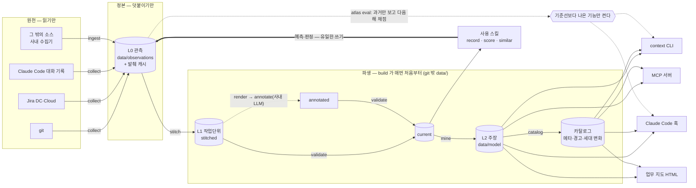
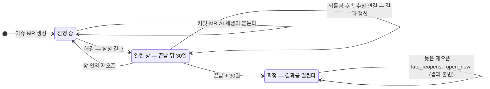
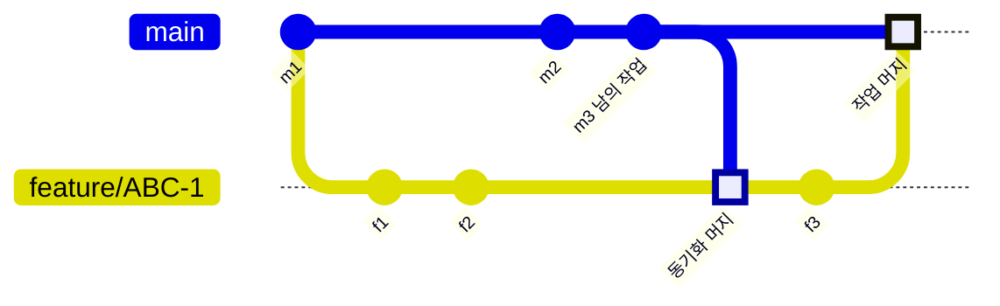

# 엔진 구조

> 왜 이렇게 생겼는지(원칙)는 `METHODOLOGY.md`, 데이터 계약은 `method/schema.md`, 효용의 실측은 `EVALUATION.md`.
> 여기는 엔진(`atlas/`)이 무엇을 어떤 순서로 만들고, 어디에 두고, 어디를 넓히면 되는지를 적는다.

## 한눈에

`python -m atlas build` 가 stitch 부터 report 까지를 매번 처음부터 다시 만든다. 수집은 `atlas collect all`(또는 `build --collect`).

## 두 층의 지식

| 층 | 무엇 | 언제부터 | 사람·LLM 비용 |
|---|---|---|---|
| **결정론 마이닝** | 함께 바뀌는 파일 · 결함이 몰린 파일 · 처리 통계 · 실천과 결과 · 비슷한 과거 작업 | 수집한 날부터 | 없음 |
| **의미 (원형·어휘)** | 일의 모양(원형) · 함정 · 숨은 하위작업 · 처리 수와 결과 | 첫 도출(BOOTSTRAP A3) 뒤 | LLM 주석 + 사람 판정 |

- 마이닝 층은 라벨 없이 첫날부터 쓸모가 있고, 그 쓸모를 시간 분할로 잴 수 있다(EVALUATION.md).
- 의미 층은 "어떤 종류의 일인가·어떻게 처리했나"를 다룬다. 마이닝이 못 하는 일이다.
- 두 층은 같은 작업단위(WU)와 같은 소비 경로를 쓴다.
- 엔진은 의미 층 가운데 도구에 묶이지 않는 부분을 제공한다: 입력 문서·사후 검증·기록·채점·유사 사례. LLM 실행 환경에 묶인 주석(annotate)은 사내에서 만든다.

## 모듈

| 모듈 | 하는 일 | 입력 → 출력 |
|---|---|---|
| `config` | `atlas.toml` + 기본값, 키·결함·역할 패턴 | → 설정 |
| `collect/git` | 커밋·머지 → `vcs.commit`·`vcs.merge`. 키·경로·이름 바뀜·MR·되돌림, 증분 | git → L0 |
| `collect/jira` | DC v2·Cloud v3. 생성 당시 라벨 복원, 상태·해결·변경·연결·댓글. 재시도·증분 | REST → L0 |
| `collect/claude_code` | 세션 요약 → `ai_session.session`. 편집 파일·테스트 실행·커밋·오류·압축 | `~/.claude/projects` → L0 |
| `ingest` | 외부 수집기 JSONL 검증 후 덧붙임 | JSONL → L0 |
| `store` | 검증·중복 제거·월별 덧붙이기·발췌 캐시·증분 상태 | — |
| `stitch` | 객체 중심 상관, 사후 신호, 결과 계산, as_of 재생 | L0 → `stitched.jsonl` + 보고 |
| `render` · `validate` | LLM 입력 문서 · 주석 사후 검증 (R1~R4) | L1 → 문서 · `current.jsonl` |
| `mine/*` | corpus(경로 정규화) → cochange · hotspot · process · practice · moves · text | current + L0 → `data/model/` |
| `catalog` | 소스 신선도·커버리지·고아·세대 변화·AI 세션 메타 → 경고와 권하는 조치 | 전부 → `catalog.json` |
| `context` · `hook` · `mcp_server` · `report` | 소비 — Claude 용 맥락, 편집·프롬프트 순간 주입, MCP, 사람용 HTML | `data/model` → 출력 |
| `record` · `score` · `similar` | 예측·판정 기록(유일한 사람 쓰기 경로), 채점, 원형 기준 유사 사례 | L0·current |
| `evaluate` | 시간 분할 효용 평가(기준선·부트스트랩) | L0 → 평가 JSON |
| `pipeline` | build 순서·시간 기록·주석 이어 붙이기 | — |
| `check` · `schema_gen` | 커밋 전 무결성 · 코드북 → 주석 스키마 | — |

## 파일

| 경로 | 만드는 것 | 읽는 것 | git |
|---|---|---|---|
| `data/observations/YYYY-MM.jsonl` | collect · ingest · record | 전부 | 밖 |
| `data/excerpts.jsonl` | 수집기(가린 뒤 자른 본문) | stitch · mine · render | 밖 |
| `data/state/` | 수집 증분 · 훅 세션 기록 · 훅 오류 로그 | 수집기 · 훅 | 밖 |
| `data/units/{stitched,annotated,current}.jsonl` · `stitch_report.json` | stitch · 사내 annotate · validate | mine · score · similar · context | 밖 |
| `data/model/claims.jsonl` · `paths.json` · `text_index.json` · `generation.json` · `catalog.json` · `build.json` · `history/` | mine · catalog · build | context · hook · MCP · report | 밖 |
| `data/reports/atlas-<세대>.html` | report | 사람 | 밖 |
| `out/` · `reports/` | 사내 카드 레시피(원형 단위 집계) | 사용 스킬 | 안 |

`data/model/` 이 git 밖인 이유: 주장의 근거에 작업단위·커밋 id 가 있다. WU 단위 귀속은 git 에 남기지 않는다(METHODOLOGY.md §11).

## 작업단위의 수명 — 결과는 언제 정해지나

- 결과는 끝난 순간이 아니라 열린 창(`policy.open_window_days`, 기본 30일)이 지난 뒤 확정한다. 창 안의 재오픈·되돌림·사람이 남긴 후속 수정 연결이 결과를 바꾼다. 연결 신호의 시각은 연결이 처음 관측된 때다.
- 확정되면 이슈 상태를 얼린다. 늦은 재오픈은 `late_reopens` 로 세기만 하고, 지금 열려 있으면(`open_now`) 맥락이 "확정 뒤 다시 열려 지금 진행 중"이라고 따로 알린다. 실데이터 예: LANG-1291.
- 결과의 우선순위는 `rolled_back` > `followup_fix` > `reopened` > `abandoned` > `clean` 이다. 파일 수준 SZZ 근사는 결과에 쓰지 않는다(`followup_suspected`).
- 계약은 `method/schema.md` 의 L1 규칙.

## 동기화 머지 — 들인 커밋은 누구의 작업인가

- **작업 머지**의 둘째 부모(f3)는 기능 브랜치 위에 있다. 들인 커밋 f1~f3 이 ABC-1 의 작업이다.
- **동기화 머지**는 메인라인(m3)을 기능 브랜치로 들인다. m3 은 남의 작업이라 ABC-1 에 넣지 않는다.
- 판정은 두 겹이고 L0 의 `sync_merge` 로 남는다.
  - 메시지: 들여온 브랜치가 메인라인이다. GitHub PR 은 받는 쪽이 메시지에 없어 원격 소유자(`owner`, 없으면 upstream·ref 의 원격·origin)와 같을 때만 동기화다. 같은 이름 브랜치로 들인 MR(포크의 main → main)은 작업이고, 커밋·태그를 기능 브랜치로 들인 머지는 MR 이 아니면 동기화다.
  - 구조: 둘째 부모가 수집하는 ref 의 첫 부모 사슬 위에 있다. 메시지 형식과 무관하다.
- 메시지 형식은 호스팅마다 달라 독립 검토마다 새 구멍이 나왔다. 구조 판정이 그 부류를 형식과 무관하게 막는다. 둘 다 아니면 작업으로 둔다 — 진짜 작업을 버리지 않는 쪽으로 틀린다.

## 설계 결정 — 무엇을, 왜

| 결정 | 이유 | 근거 |
|---|---|---|
| **WU 는 이슈 단위, 관측은 여러 WU 에 속할 수 있다**(다대다). 키가 3개를 넘는 커밋은 잇지 않는다 | 합집합으로 묶으면 여러 키를 단 커밋이 이슈들을 사슬처럼 이어 거대한 덩어리를 만든다. 객체 중심 로그의 원칙이기도 하다 | van der Aalst 2019 · OCEL |
| **동기화 머지**(메인라인을 들여오는 머지)는 들여온 커밋을 쓰지 않는다. 메시지와 구조 두 겹으로 판정한다(위 절) | 쓰면 메인라인의 남의 커밋이 그 이슈의 작업단위로 들어간다("Merge branch 'develop' into feature/X" 는 흔하다). 모를 때는 진짜 작업을 버리지 않는 쪽으로 | LANG 에서 43·36 커밋짜리 가짜 묶음이 사라짐(독립 검토) · 테스트 `test_sync_message_forms` · `test_collector_marks_sync_structurally_and_lists_unknown_work` |
| **브랜치 이름은 해시로만 남긴다**(기본). 트레일러(Signed-off-by 등)의 이름은 발췌에서 뺀다 | jdoe/PROJ-1·owner:patch-1 처럼 이름에 계정이 들어가는 관례가 흔하고, L0 는 나중에 지울 수 없다. 조인은 같은 규칙의 해시로 된다 | — |
| **as_of 이후는 보지 않는다.** 세대 id = 관측 id·설정·레시피 버전의 해시 | 같은 입력이면 같은 결과다. 시간 분할 평가와 재빌드 비교가 여기에 기댄다. 레시피의 의미가 바뀌면 버전을 올려 옛 세대와 섞이지 않게 한다 | 테스트 `test_deterministic` · `test_as_of_hides_future` · `test_generation_id_covers_stitch_recipe` |
| **이슈 라벨은 생성 당시 값으로 되감는다.** 이후 변경은 사건으로 남긴다 | 지금 값을 생성 시각에 붙이면 미래가 샌다 | LANG 에서 유형이 바뀐 이슈 45건 |
| **설정에 기대는 판정은 빌드 때 다시 한다**: 결함 수정 여부, 키 거르기 | L0 는 덧붙이기만 하고 obs_id 로 중복을 거른다. 수집 때 판정을 박아 두면 규칙을 고쳐도 영영 옛 값이 남는다 | — |
| **커밋의 결함 수정 여부는 이어진 이슈의 유형이 정한다.** 이슈가 없을 때만 메시지 패턴 | "Applying X's patch" 같은 메시지가 Improvement 이슈의 커밋을 결함 수정으로 셌다 | LANG 143건·ZK 248건이 잘못 세어짐(독립 검토) |
| **결과는 열린 창 안의 사후 사건으로만 정한다** — 확정되면 얼리고, 지금 상태는 따로 보여 준다(위 절) | 창 밖의 되돌림·연결·재오픈까지 세면 "확정"이 확정이 아니고, 오래된 WU 일수록 문제율이 높아 보인다. 늦은 재오픈이 종료 시각을 옮기거나 늦게 단 연결이 옛 날짜로 들어와도 같은 일이 생긴다 | 테스트 `test_settled_outcome_is_final` · `test_late_link_and_late_reopen_do_not_change_settled_outcome` |
| **장부 파일을 마이닝·귀속에서 뺀다** (`mining.ignore_paths`) | 거의 모든 커밋에 따라 바뀌어 추천을 독차지하고 귀속을 오염시킨다 | LANG changes.xml 17% · pom.xml 8% |
| **SZZ 근사는 `followup_suspected` 로 분리한다** | 파일 수준 근사의 표본 정밀도가 약 25%다. 결정론 신호의 자격이 없다 | EVALUATION.md 결과 5 |
| **맥락은 혼합, 훅은 엄격** | 혼합(규칙 → 이름 짝 → 같은 디렉터리)은 재현율이 가장 높다. 편집 순간에는 정밀도(신뢰도 ≥ 0.5)를 우선한다 | EVALUATION.md 결과 1 |
| **핫스팟 순위 기본값은 결함 수정 수** | 두 저장소 모두 상위 20 정밀도가 가장 높고 "결함 수정 N건"으로 읽힌다. 포착률이 가장 높은 기준은 저장소마다 달라 `atlas eval` 로 고른다 | EVALUATION.md 결과 2 |
| **소요 시간은 예측하지 않는다** | 비슷한 작업 기반 추정이 기준선보다 낫지 않았다. 분포(처리 통계)만 보여 준다 | EVALUATION.md 결과 4 |
| **AI 세션은 마지막 관측만 쓴다** | 세션은 이어 쓰이며 커진다. obs_id 에 줄 수를 넣어 덧붙이기만 하고, 읽을 때 최신을 고른다 | — |
| **사후 결과는 이슈 WU 에서만 센다** (처리 통계·실천) | MR·세션 WU 에는 재오픈을 관측할 길이 없다. "문제 없음"이 "관측 못 함"과 섞인다 | — |
| **모델 파일에 형식 버전을 둔다** | 구조가 바뀐 뒤 옛 파일을 조용히 잘못 읽으면 훅이 말없이 아무것도 안 한다. 맞지 않으면 '다시 빌드'라고 말한다 | 이 구현 중 실제로 겪었다 |
| **훅은 막지 않는다.** 어떤 오류·종료에도 출력 없이 0, 인스턴스가 아닌 루트에는 아무것도 쓰지 않는다. 세션·파일마다 한 번만 말하고 1,500자로 자른다 | 작업 흐름을 방해하면 끈다 | 테스트 `test_hook_never_blocks` |
| **훅의 입출력은 UTF-8 바이트**, 명령은 셸 문법(환경 변수 접두)에 기대지 않고 경로를 인자로 넘긴다 | Windows 의 파이프는 시스템 코드 페이지(cp949)라 한글 프롬프트에서 훅이 조용히 죽었다. 같은 설정이 Windows·macOS·Linux 에서 돌아야 한다 | cp949 재현(독립 검토) · 테스트 `test_hook_reads_and_writes_utf8_bytes` |
| **평가의 신뢰구간은 군집 부트스트랩** (동반 변경은 커밋, 핫스팟은 파일) | 같은 커밋의 질의, 같은 파일의 접촉은 독립이 아니라 질의 단위로 뽑으면 구간이 좁아진다 | 유의 시점 수가 일부 줄었다 — EVALUATION.md |
| **MCP 는 읽기 전용이다.** `ingest` 는 사람·사용 사건(atlas·self_report)을 받지 않는다 | 사람 쓰기 경로는 `record` 하나다(P7). 그래야 트리아지 없는 판정 같은 것이 들어오지 않는다. SDK 1.x(FastMCP)·2.x(MCPServer) 둘 다 받는다 | 실측: mcp 1.30 · 2.2 |
| **수집기는 자격 증명을 같은 호스트의 https 에만 보낸다.** 리다이렉트가 다른 호스트나 http 로 가면 떼고, 설정이 https 가 아니면 처음부터 보내지 않는다 | urllib 은 리다이렉트에 Authorization 을 그대로 실어 보낸다 — SSO·프록시로 새지 않게 | 테스트 `test_jira_redirect_strips_auth_and_requires_https` |

## 넓히는 곳

- **새 소스**: 관측 계약에 맞는 JSONL 을 내는 수집기를 어떤 언어로든 만들어 `atlas ingest` 로 넣는다. 결정론 obs_id 가 필수다.
  - 엔진 안에 넣으려면 `atlas/collect/<이름>.py` 에 `add_args` · `source_from_args` · `collect` 를 두고 `collect/__init__.py` 의 표에 더한다.
- **주석(LLM)**: `data/render/` 문서를 읽어 `annotation.schema.json` 형식으로 주석하고 `data/units/annotated.jsonl` 에 쓴다.
  - 각 WU 의 `build.input_hash` 에 문서 해시를 넣는다.
  - 다음 build 가 해시가 같은 주석만 이어 붙이고, 바뀐 것은 다시 주석할 것으로 센다.
- **새 마이너**: `mine/claims.make` 로 주장을 만들고 `mine.run` 에 더한다. 강도 정의를 그 모듈 문서에 적는다.
  - 효용을 주장하려면 `evaluate` 에 과제를 더한다.

## 성능 (실측, 2026-10-13, 이 개발 환경, 벽시계 — 파이썬 시작 포함)

| | LANG (관측 28,074) | ZK (관측 76,327) |
|---|---|---|
| 첫 전수 수집 (git + Jira) | 58초 (git 단독 16초) | 3분 8초 |
| `build` (stitch → report, 3회) | 7~8초 | 19~21초 |
| `context` 한 번 (이슈 + 파일) | 0.4초 | 0.9초 |
| 훅 한 번 (파일 편집) | 0.2~0.3초 | 0.2~0.3초 |
| `eval` 시점 하나 (4과제, 5개 시점 평균, 2회) | 9~10초 | 17초 |

## 남겨 둔 시드 — 아직 켜지 않은 것

| 시드 | 켤 때 | 왜 아직 아닌가 |
|---|---|---|
| 줄 수준 SZZ (결함 수정 커밋의 지운 줄을 `git blame`) | 사후 귀속을 결정론 신호로 쓰고 싶을 때 | 수집 비용이 크다. 줄 수준에서도 정밀도가 보장되지 않는다(Herzig & Zeller 2013) |
| 키 없는 커밋 군집 (시간·경로) | 고아 비율이 높고 키 습관을 바꿀 수 없을 때 | 휴리스틱 WU 가 통계를 흐린다. 먼저 키 습관을 권한다(카탈로그 제안) |
| Stop 훅: 세션 끝에 높은 신뢰도 짝을 안 바꿨으면 상기 | 훅 힌트의 실제 효용을 판정(`record`)으로 확인한 뒤 | 잔소리가 되기 쉽다 |
| 이슈 키 없는 프롬프트에 유사 작업 자동 주입 | 사내에서 텍스트 검색 정밀도를 확인한 뒤 | 모든 프롬프트에 끼어드는 소음 위험 |
| 디렉터리·모듈 수준 동반 변경 | 파일 수준 응답률이 낮은 저장소 | 파일 수준 + 혼합으로 아직 충분 |
| 한국어 형태소 분석 | 음절 바이그램 검색이 사내 데이터에서 약할 때 | 외부 의존 없이 시작한다 |
| MR·리뷰 수집기 (GitLab·GitHub API) | 리뷰 코멘트를 처리 수(moves)의 근거로 쓸 때 | 머지 메시지·스쿼시 번호로 묶음은 이미 잡힌다 |
