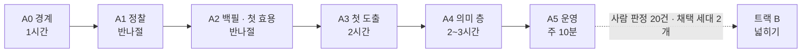

# 시작 절차

> 사내 Claude Code 세션을 사내 인스턴스 저장소 루트에서 열고, 단계마다 아래 프롬프트를 붙여 넣는다.
> **트랙 A(최소 경로)를 먼저** 끝내고, 판정(사람 판정 20건 이상)을 통과하면 트랙 B로 넓힌다. 근거는 `METHODOLOGY.md` §12.
> 각 단계는 종료 기준을 수치로 확인한 뒤 넘어간다. 시간은 사람 기준 추정치다.
> 개념과 용어(도출 · 주석 · 판정 · 채택 세대 · 주간 수확 …)는 [`CONCEPTS.md`](CONCEPTS.md) — 사내 Claude 에게도 먼저 읽게 하면 단계별 대화가 짧아진다.

## 무엇이 준비돼 있고, 무엇을 만드나

| 부분 | 상태 |
|---|---|
| 수집(git · Jira DC/Cloud · Claude Code · 작업 공간) · ingest · 상관 · 마이닝(업무 카테고리 포함) · 카탈로그 · 맥락 · 훅 · MCP · 업무 지도 · 업무 안내서 · 평가 · 기록 · 사후 검증 · 입력 문서 · 채점 · 유사 사례 · 점검(`atlas doctor`) | **엔진에 있다** (`atlas/`, 테스트됨, 공개 실데이터로 평가됨 — `EVALUATION.md`) |
| LLM 작업 — 주석(`annotate`) · 카테고리 해설 · 주간 요약 · 이름 제안 · 작업 기록 초안 (`atlas llm`) · 실측(`atlas llm bench`) | **엔진에 있다** — 근거 검증 · 캐시 · 장부 · 예산까지. **사내에서 정한다**: 어느 백엔드를 승인하나(Claude Code 헤드리스 · 사내 게이트웨이 · 없음), 그 인증(A0) |
| 도입 · 무인 운영 — 설정 초안(`atlas init`) · 사내망 점검(`atlas doctor --online`) · 주간 수확(`atlas harvest`) · 정기 실행(`atlas schedule`) · 보존 기한(`[retention]`) · 쓰임 실측(`atlas usage`) | **엔진에 있다** |
| 그 밖의 소스 수집기(메신저·메일·위키·배포·GitLab MR 등) | **사내에서 만든다** — 수집기 도구(`atlas.collect.sdk.Kit`)와 골격(`method/recipes/collector_template.py`)으로 관측 계약에 맞는 JSONL 을 내서 `atlas ingest` 로 넣는다(`method/schema.md` "사내 수집기가 내는 사건") |
| 원형 카드 `cards` | **사내에서 만든다** — 원형이 사내 도출(A3)에서 나온다(A4) |

## 준비 (10분)

1. 이 템플릿을 사내 private 저장소로 복제하고 `.template` 파일을 지운다(템플릿 전용 검사 해제). 회사 데이터는 사내 인스턴스에만 둔다.
   `LICENSE`(MIT 고지)는 지우지 않는다. 회사에 오픈소스 관리 절차가 있으면 반입 목록에 등록한다.
2. `pip install -e .` (Python 3.11 이상) — `atlas` 명령이 생긴다. MCP 서버를 쓸 거면 `pip install "mcp>=1.2"`. 훅을 더 빠르게 하려면 `pip install -e ".[fast]"`(orjson — 없어도 결과는 같다).
   사내 PC 가 PyPI 에 못 닿으면, 닿는 PC 에서 휠을 받아 옮긴다(의존성은 PyYAML · jsonschema 와 그 의존성, 빌드용 setuptools):
   `pip download -d wheels --only-binary=:all: --platform win_amd64 --python-version 3.12 "pyyaml>=6.0" "jsonschema>=4.18" "setuptools>=77"`
   → 사내 PC 에서 `pip install --no-index --find-links wheels -e .` (플랫폼 · 파이썬 버전은 사내 PC 에 맞춘다).
   pip 이 사내 프록시 · CA 에 막히면 `pip config set global.cert <회사 루트 PEM>` · `HTTPS_PROXY` 를 먼저 맞춘다.
3. `git config core.hooksPath .githooks` — 커밋 전 무결성 검사를 켠다.
4. `atlas check` 가 `integrity ok`, `python -m unittest discover -s tests` 가 전부 통과하는지 본다.
5. `atlas doctor` — 환경 · 설정(소스 포함) · 방법 · 데이터 · 소비 · LLM 이 각각 되는지(ok), 권하는 것이 빠졌는지(!), 막혔는지(✗)와 다음 할 일을 본다. 단계마다 다시 돌린다.
   `atlas doctor --online` 은 네트워크까지 본다 — Jira 에 닿는지(인증 없이 서버 정보), 자격 증명이 통하는지, claude 백엔드가 어떻게 격리되는지.
   사내 CA · 프록시에서 막히면 원인과 할 일을 말한다(`ca_bundle` · `tls_strict` · `HTTPS_PROXY` · `NO_PROXY` — `atlas.example.toml` 의 Jira 절).
6. **Windows**: 명령과 인자는 PowerShell 에서도 같다. 경로는 `atlas.toml` 에 `C:/work/repo` 처럼 슬래시로 적거나 작은따옴표 문자열(`'C:\work\repo'`)로
   (`atlas init` 은 알아서 이스케이프한다). 무인 실행(작업 스케줄러)은 `pythonw` 로 돌게 했고, git · claude 자식 프로세스도 콘솔 창 없이 띄운다.
   출력을 파일로 받을 때(`atlas guide … > 안내.md`)는 `$env:PYTHONUTF8 = 1` 로 UTF-8 이 되게 한다 — 아니면 시스템 코드 페이지로 쓰인다.
   엔진 테스트는 CI 에서 Windows 로도 돈다. 작업 스케줄러 등록 · `pythonw` 는 실기에서 재지 못했다 — 사내 PC 에서 처음 한 번은
   `Start-ScheduledTask` 로 돌려 `data\state\harvest-last.json` 을 본다.

---

## 트랙 A — 최소 경로



### A0. 경계 (1시간)

```text
이 저장소는 work-atlas 사내 인스턴스다. CLAUDE.md, METHODOLOGY.md, method/policy.md 를 먼저 읽어라.
A0 단계다. 아직 어떤 데이터도 수집하지 마라.
1) 이 세션에서 닿을 수 있는 업무 시스템을 도구 목록·MCP 설정·설치된 CLI로 실측해 표로 보여줘
   (시스템, 접근 방식: API/CLI/MCP, 읽기·쓰기 범위, 인증 형태). 확인 못 한 칸은 [미확인].
2) method/policy.md §1 의 빈칸 중 내가 답해야 하는 것만 한 번에 묶어 질문해라.
   특히 data/ 를 둘 사내 저장 경로, Claude Code 대화 기록·Jira 본문을 처리해도 되는 범위, --bare 실행에 쓸 LLM 인증 형태,
   그리고 atlas llm 의 백엔드(none 그대로 · Claude Code 헤드리스 · 사내 게이트웨이) — 승인 전에는 none 이다.
내 답을 받으면 policy.md §1 을 채우고, method/DECISIONS.md 를 만들어 첫 결정들을 한 줄씩 기록해라.
```

종료 기준: 데이터 경계·저장 경로·실행 위치·본문 처리 범위가 문장으로 기록됨.

### A1. 정찰 — 트래커와 형상관리 (반나절)

```text
A1 단계(정찰 실측)다. 소스는 이슈 트래커와 형상관리 두 개만, 읽기 전용.
1) atlas init --repo <저장소 경로>(여럿이면 반복) --jira-url <주소> --workspace <작업 폴더 루트> 로 atlas.toml 초안을 만든다
   — git 로그에서 내 이메일 · 이름, 커밋 제목 · 브랜치의 프로젝트 키(3회 이상 · 2% 이상)와 그 커버리지, 원격 기본 브랜치를,
   ~/.claude/projects 가 있으면 Claude Code 기록 폴더 이름을 읽어 채운다. --print 로 먼저 보고, 이미 있으면 덮어쓰지 않는다.
   그 뒤 채우거나 고칠 것:
   identity.self(Jira 사용자 · accountId 를 더한다), keys.projects(빠진 키), [[sources.git]], [[sources.jira]](jql · done_statuses).
   자격 증명은 값이 아니라 환경 변수 이름만 적는다(auth_env). 정책이 허용하면 [[sources.claude_code]] 도.
   identity.roles 에 역할(codebook roles 의 id) → 팀 메일·그룹 계정·도메인 패턴을 적는다 — 개인 이름은 적지 않는다.
   수집할 때 적용되므로(지난 관측은 그대로) 첫 수집 전에 정한다. 업무 카테고리의 순서 그림과 접점의 "누가"가 여기서 나온다.
   이슈·업무마다 작업 폴더를 쓰고 있으면 [[sources.workspace]] 도 — 내가 쓴 파일이라 부담이 작고,
   그 폴더에서 연 세션이 이슈에 붙는다(켠 뒤 수집한 세션부터 — 이미 수집한 세션은 고치지 않는다).
   형식과 이유는 WORKSPACE.md. 기존 폴더는 그대로 두고 atlas work status 로 먼저 본다.
   트래커가 Jira 가 아니면 그 트래커의 수집기를 관측 계약(method/schema.md "제공 수집기가 내는 사건")에 맞춰 만들어
   JSONL 로 내고 atlas ingest 로 넣는다 — 이슈 생성 라벨은 생성 당시 값으로(변경 이력 되감기).
2) atlas doctor --online 으로 Jira 연결(사내 CA · 프록시 · 토큰)을 먼저 확인하고, atlas collect all --dry-run 으로 계약 위반이 0 인지 본 뒤
   최근 14일로 시험하고 문제가 없으면 실제로 수집해라.
3) atlas build 후 atlas catalog 를 보여줘라. 커밋 이슈 키 커버리지·고아 비율·부분 수집·업무 카테고리 미분류 비율을 읽고,
   내가 최근 한 업무 5건(계획 기능·결함·운영 요청·긴급·문의)이 어떻게 이어졌는지 atlas context --issue 로 확인해라
   (카테고리 줄 — 지금 단계 → 보통 다음 — 이 내 감각과 맞는지도).
4) method/sources.yaml 에 소스별 측정값(수집기 종류·원천 보존 기한·키 커버리지·편향 메모)을 [실측]으로 남기고
   policy.md §2 표를 채운다 — 여기는 결정, sources.yaml 은 측정.
```

종료 기준: 계약 위반 0 · 키 커버리지 · 고아 비율 · 미분류 비율이 수치로 있음 · 5건 종단 추적.

### A2. 백필 · 첫 효용 · 훅 · 블라인드 골든 (반나절)

```text
A2 단계다.
1) 최근 6~12개월을 백필하고(atlas.toml since 조정 후 atlas collect all) atlas build.
2) 내 저장소에서 효용을 잰다:
   atlas eval --cutoff <석 달 전> --cutoff <여섯 달 전> --horizon-days 90
   결과를 EVALUATION.md 의 표와 같은 형식으로 보여주고, 기준선보다 유의하게 낫지 않은 기능은 소비 경로에서 끄자고 제안해라
   (policy.md §7 "마이닝 효용"). 결정은 DECISIONS.md 에 한 줄.
3) 쓸모가 확인된 것만 켠다:
   - 훅: atlas hook --print-settings 의 결과를 ~/.claude/settings.json hooks 에 합친다(작업 폴더에서도 동작한다 —
     프로젝트 설정은 상위 폴더에서 이어받지 않는다). 한 저장소에서만 쓰려면 그 저장소의 .claude/settings.json.
     훅 · 맥락이 낸 제안은 data/usage/ 에 쌓이고 atlas usage 가 실제 반영률을 낸다. 훅이 행동을 바꾸는지까지 보려면
     [usage] holdout = 0.2 로 세션의 20% 에서 동반 변경 후보를 알리지 않는다(policy.md §3 — 판정이 나면 0 으로 되돌린다).
   - 작업 공간(쓰는 경우): atlas work init 으로 루트에 공통 규칙을 두고, 새 일은 atlas work new <이슈 키>.
   - 사용 스킬: method/skill/atlas/SKILL.md 의 ATLAS_HOME 을 채우고 ~/.claude/skills/atlas 로 심볼릭 링크.
   - 업무 지도: atlas report 의 HTML 을 열어 본다(git 밖).
4) 업무 카테고리를 다듬는다(CHANNELS.md §2.4): 업무 지도의 카테고리 트리와 data/reports/guides/README.md 를 보고
   경로 규칙 후보 · merge · parents 를 method/categories.yaml 에 제안해라 — 내가 고른 것만 넣고 바꾼 이유는 DECISIONS.md 에 한 줄.
   자주 보는 카테고리 3~5개에 contacts(팀 · 채널 · 역할 — 사람 이름 금지)와 references(런북 · 설계 문서)를 내게 물어 채운다.
   다시 빌드해 미분류 비율이 policy.uncategorized_max 아래인지 본다. 안내서는 atlas guide 로 위키에 올릴 Markdown 이 나온다.
5) 입력 문서(atlas render)를 만들고, 블라인드 골든 20건을 고른다(규모·기원이 고르게, 재오픈·롤백 흔적 포함).
   먼저 나에게 입력 문서만 보여주고 트랙 A 패싯(codebook active_from: A) 라벨을 받는다.
   내 답을 받은 뒤에만 네 제안을 보여줘라. method/golden/labels.csv 에 blind=true, codebook_version 과 함께 기록한다.
```

종료 기준: 평가 결과 기록 · 훅·스킬 켜짐 · 카테고리 정의 첫 손질 · 블라인드 골든 20건.

### A3. 첫 도출 (2시간)

```text
A3 단계(첫 원형 도출)다. METHODOLOGY.md §6.1 을 축소해서 한다.
1) 이 세션에서 개방 코딩 1회: 입력 문서(data/render)를 훑어 후보 원형·함정·하위작업·처리 수를 만든다.
2) 격리 블라인드 도출 1회: 새 임시 폴더에 표본 WU의 입력 문서만 넣고(예외 트랙 WU 는 반드시 포함 —
   stitch 의 deterministic_signals 가 있는 것), 그 폴더에서 claude --bare -p 로 실행한다.
   프롬프트는 method/prompts/rederive.md 의 --- 아래 본문만 보내고, 시드 없는 실행이므로 {{SEEDED}} 는 빈 문자열로 바꾼다.
   이 저장소의 문서·코드북·네 1)번 결과가 그 프로세스에 보이면 안 된다.
3) 두 결과를 소속 WU 겹침으로 대응시켜 비교표를 보여주고, 원형 10개 이하로 병합하는 안을 낸다.
   예외 트랙(장애·롤백·후속 수정·결제 사고) 범주는 1건이어도 남긴다.
   트래커 라벨(유형·컴포넌트)과 거의 같은 원형은 따로 표시한다 — 이 체계의 추가 가치가 없는 부분이다.
4) 내가 채택한 원형과 어휘를 codebook.yaml 에 코드북 형식으로 기록한다(examples 는 실제 WU 앵커만).
   version 을 1로 올리고 atlas gen-schema 로 스키마를 다시 생성한다. 골든셋 20건에 원형 라벨을 블라인드로 받는다.
```

종료 기준: 원형 v1(10개 이하) · 잔차 목록 · 골든셋 원형 라벨.

### A4. U1 의미 층 (2~3시간)

```text
A4 단계다. U1 트리아지의 의미 층을 붙인다.
1) 주석: A0 에서 승인한 백엔드를 atlas.toml [llm] 에 적고(예산 max_usd_* 포함 — policy.md §4) atlas llm run annotate --dry-run 으로
   대상을 본 뒤 --limit 로 나눠 돌린다. 엔진이 입력 문서(atlas render 와 같은 것)와 코드북을 보내고, annotation.schema.json 으로
   받아 data/units/annotated.jsonl 에 쓴다. 다시 주석할지는 입력 해시 · 레시피 · 코드북 버전 · 코드북 내용 · 프롬프트로 정한다.
   백엔드가 아직 없으면 atlas llm prompt annotate --key <wu> 를 이 세션에 붙여 답을 받고 atlas llm import 로 들인다(같은 검증).
2) atlas build 가 해시가 같은 주석만 이어 붙이고 atlas validate 로 사후 검증한다(→ current.jsonl). 위반률과
   atlas llm status(통과율 · 거절 이유 · 비용)를 보여줘라. atlas llm stability annotate --sample 3 으로 재표집 일치도도 잰다(월간 재빌드에서는 --share 0.15).
3) method/recipes/cards.py: 원형 카드를 out/cards/ 에 만든다. 형식은 METHODOLOGY.md §8.
   카드에는 어휘 id와 건수만 둔다(WU 링크 없음). 함정은 결정론 신호가 있는 것만. 처리 수별 결과는 data/model/claims.jsonl 의
   moves 주장(원형별 깔끔 종료·후속 문제 건수)을 쓴다. 마지막에 out/MANIFEST.json 을 쓴다.
4) 실제 업무 3건에 사용 스킬로 브리프를 내고 예측·판정을 atlas record 로 남긴다.
```

종료 기준: 실제 업무 3건 사용 · L0에 예측·판정 사건 · `atlas check` 통과.

### A5. 운영 (주 10분)

```text
A5 단계다. policy.md §1 의 실행 위치에 맞춰 주기 작업을 정의한다.
- 일일 표집: 하루 한 번 "오늘 기록 없이 한 일" 한 줄을 묻고 atlas record self-report 로 남긴다.
- 주간 수확(무인): atlas harvest 한 명령 — 수집(소스 하나가 실패해도 나머지) → 보존 기한([retention]) → 빌드([llm] auto 포함)
  → 채점(원형·규모 예측은 WU 가 끝났을 때 잠정, 함정·처리 수는 확정됐을 때) → data/reports/<날짜>-harvest.md(git 밖):
  실패 · 수집 · 지운 것 · 세대 변화 · 경고(새 것 표시) · 채점 · 쓰임 · 확인 질문 5건 이내(판정이 없는 끝난 일 + 수신함) · 4주 지난 수신함.
  정기 실행은 atlas schedule 이 붙여 넣을 설정을 낸다 — Windows 는 작업 스케줄러 PowerShell(꺼져 있어 지나친 실행은 켜진 뒤 바로),
  macOS 는 launchd, 그 밖은 cron. --quiet 라 정상 · 무변동은 침묵하고, 실패는 종료 코드 1 · data/state/harvest-last.json ·
  atlas doctor 가 알린다. Claude Code 대화 기록은 30일 뒤 지워지므로 수집 주기를 그보다 짧게 둔다.
- 보존 기한: policy.md §2 의 캐시 보존을 atlas.toml [retention] 에 옮긴다(발췌 · LLM 답 캐시 · 리포트, 0 은 보존).
- 작업 정리(사람, 주 1회 몇 분): atlas work status 로 오래 방치된 작업·결과 없이 끝난 작업·트래커와 어긋난 상태를 보고
  atlas work close 로 맞춘다. 무인 수확은 작업 폴더를 읽기만 한다.
- LLM(백엔드를 승인했으면): 먼저 atlas llm bench --sample 8 --max-usd 3 으로 내 데이터에서 통과율 · 버린 문장 · 재표집 일치도 ·
  비용 · 지연을 잰다(리포트에 판정할 카드 목록이 나온다). 주간 수확 뒤 atlas llm run weekly_digest 로 주간 요약을, 카테고리 모양이 바뀐 것만
  atlas llm run category_card 로 다시 받는다(캐시가 나머지를 건너뛴다). 업무 지도 · 안내서의 해설을 읽다 틀린 것은
  atlas record llm-feedback --key '<카테고리>' --verdict wrong 으로 내린다. 사람 판정이 10건 넘게 쌓이고 쓸모 있음 비율이
  policy.llm_useful_min 이상이면 [llm] auto 에 넣어 수확의 빌드가 이어서 돌리게 한다.
- 분기마다 atlas eval 을 다시 돌려 효용이 유지되는지 본다.
- 월간 재빌드: 15% 재주석(atlas llm stability annotate --share 0.15) 포함 → out/ 교체 + 지표 표(원형 단위 집계는 reports/) → 내가 git tag gen-YYYY-MM 으로 채택.
- atlas llm 의 claude 백엔드는 도구를 모두 끄고(--tools "") MCP 를 막은(--strict-mcp-config) 채 빈 임시 폴더에서 부른다.
  인증이 로그인(구독)뿐이면 [llm] bare = false — --safe-mode 로 사용자 설정(CLAUDE.md · 훅 · 스킬)이 끼지 않게 한다.
  도구가 필요한 무인 호출(재도출 등)은 --bare, --permission-mode dontAsk, 최소 --allowedTools, --max-turns, --max-budget-usd,
  필요하면 --mcp-config 와 --strict-mcp-config 로 범위를 닫는다. 원천 시스템에는 쓰지 않는다.
- 알림: 정상·무변동은 침묵. 사람 결정이 필요한 것, 지표 경고, 실행 실패만 알린다.
```

**판정**: 달력이 아니라 `atlas score` 가 "판정 가능"(사람 판정 20건 이상)을 낼 때 한다 — 대개 4~8주. 원형 적중률(사람 판정 기준)과 "도움 됨"(policy.md §7)을 본다. 미달이면 카드가 아니라 용도와 트리거 지점을 다시 설계한다. 통과하면 트랙 B.

---

## 트랙 B — 넓히기 (채택 세대 2개 이후)

```text
트랙 B다. policy.md §3 의 가동 조건을 먼저 확인하고, 충족된 것만 켠다.
1) 소스 확장: 위키·메일·메신저·배포·캘린더 중 정책이 허용하는 것을 A1과 같은 방식으로 실측하고,
   method/recipes/collector_template.py 를 복사해 fetch · to_events 만 그 소스에 맞게 고친다(Kit 이 역할 · 키 · 발췌 · 해시를 지킨다).
   atlas ingest … --dry-run 의 연결 미리보기(아는 이슈 키 비율)를 본 뒤 넣는다. llm_mediated 소스는 분리 표시한다.
2) 코드북 track 을 B 로 올려 나머지 패싯을 켜고 스키마를 다시 생성한다. 골든셋을 40~50건으로 늘린다(블라인드 우선).
   패싯별 Krippendorff α 를 원시 일치율·부트스트랩 신뢰구간과 함께 계산한다. 다중값 패싯은 값별 이진 일치도.
3) 격리 독립 도출 3~5회(METHODOLOGY.md §6.1 전체): 실행마다 다른 표본 + 예외 트랙 고정 포함,
   2회 이상 시드 없음, 1회 시드 제공, 가능하면 1회 다른 모델. 합의·비교표·기존 라벨 AMI 를 낸다.
4) 일치도·재주석·안정성 게이트와 오버레이를 켠다.
5) U2~U5 의 의미 층을 U1 적중률이 기준 이상일 때 하나씩 연다.
```

**채택 세대 3개 판정**: 적중률·잔차·일치도·비용 추세로 방법의 성숙도를 판정한다. 개선이 없으면 패싯 축 자체를 원점 재도출한다.
