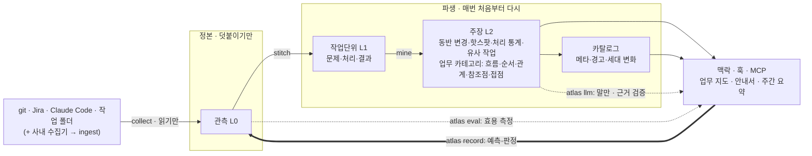

# work-atlas

[](https://github.com/d-j-lee/work-atlas/actions/workflows/integrity.yml)

현업에서 **일이 실제로 어떻게 처리됐는지**(문제·처리·결과)를 git·이슈 트래커·AI 세션·작업 폴더에서 관측하고, 그것을 캐내서 다음 일의 정체 파악·실행·사후 대처에 **다시 쓰이게** 하는 도구와 방법론이다. 실무 개발자 1인과 AI(Claude)가 대상이다.

데이터 수집이 목적이 아니다. 다시 쓰일 데이터만 모으고, 다시 쓴 안내가 실제로 맞았는지는 숫자로 잰다. 일은 **업무 카테고리**(영역 › 유형)로 묶어 카테고리마다 보통의 흐름 · 병목 · 참여자 순서 · 관계 · 참조점 · 접점을 계산하고, 사람이 보는 채널(업무 지도 · 안내서 · 주간 요약)과 Claude 가 읽는 채널(맥락 · 훅 · MCP)에 같은 지식을 낸다. LLM 은 그 위에서 말만 한다 — 숫자는 계산이 내고, 근거 검증을 통과한 문장만 싣는다.

> **처음이면 [`CONCEPTS.md`](CONCEPTS.md) 부터.** 한 건의 일이 이 도구를 어떻게 지나가는지 따라가 보고, 아래에 나오는 말(작업단위 · 고아 관측 · 열린 창 · 재현율@10 …)을 풀어 둔 용어집이 있다.

**공개 템플릿이다. 실제 업무 데이터는 여기에 두지 않는다.** 운영은 사내 private 저장소에 복제해서 하고, 관측 데이터(`data/`)는 `.gitignore`와 커밋 전 검사가 git 밖으로 막는다.

## 무엇을 해 주나

새 이슈를 받거나 파일을 고치려 할 때, 그 저장소의 과거가 Claude 와 사람에게 이렇게 닿는다. 아래는 공개 데이터(Apache ZooKeeper)로 낸 실제 출력이다(긴 경로와 일부 줄을 `…` 로 줄였다).

```text
$ atlas context --issue ZOOKEEPER-4990 --path zookeeper-server/src/main/java/org/apache/zookeeper/server/quorum/Leader.java
### work-atlas 맥락 (세대 gen-20261012-02ca5026, 기준 2026-10-12)
- `…/quorum/Leader.java` — **결함 수정이 몰린 파일**(high): 수정 41건/변경 88건, 순위 8/584, 최근 2024-10-18
  - 함께 바뀌어 온 파일: `QuorumPeer.java` 40%·32회, `LearnerHandler.java` 39%·31회
  - …
- 이슈 ZOOKEEPER-4990: Zookeeper doesn't support multiple ca into truststore — 유형 Bug · 컴포넌트 java client,other · 시작 2025-11-06 · 진행 중
- 카테고리 java client · Bug — 239건(열림 69) · 소요 중앙 46일·P90 30개월 (끝난 171건) · 사후 문제 5% (확정 169건) · 흐름 생성 → 커밋 → Resolved · 함께 든 영역: other
  - 지금 단계 생성 (2025-11-06부터) → 보통 다음: 커밋 40%(중앙 7개월) · Resolved 37%(중앙 15개월) · Patch Available 17%(중앙 11시간)
  - 가장 오래 머무는 단계 Open(중앙 33개월) · 끝난 뒤 Closed 43% · 커밋 10%
  - 참조: 주의 ZOOKEEPER-3253 · 주의 ZOOKEEPER-2184 · 대표 ZOOKEEPER-4367 · 대표 ZOOKEEPER-3280 — 자세히: atlas guide --category 'java client / Bug'
- 비슷한 과거 작업:
  - issue:ZOOKEEPER-4259 (0.35) Allow AdminServer to force https — clean · 18시간 · 변경 1
  - issue:ZOOKEEPER-3443 (0.35) Add support for PKCS12 trust/key stores — clean · 20일 · 변경 1
  - issue:ZOOKEEPER-3173 (0.31) Quorum TLS - support PEM trust/key stores — clean · 22일 · 변경 1
  - …
- 비슷한 작업들이 바꾼 파일(가능성 순, 괄호는 그 파일을 바꾼 이웃 수): `X509Util.java`(6), `zookeeperAdmin.md`(5), `ZKConfig.java`(4), …
- 읽는 법: 건수가 작으면 참고만. 함께 바뀐 것은 연관이지 인과가 아니다.
```

이 출력을 한 줄씩 읽으면:

- **결함 수정이 몰린 파일(high): 수정 41건/변경 88건, 순위 8/584** — Leader.java 는 지금까지 88번 바뀌었고 그중 41번이 결함 수정이었다. 결함 수정이 있었던 파일 584개 중 8번째로 많다. high 는 이 판단의 강도(서열)다.
- **함께 바뀌어 온 파일: QuorumPeer.java 40%·32회** — Leader.java 를 바꾼 커밋 중 40%(32번)에서 QuorumPeer.java 도 바뀌었다. 이번에도 같이 봐야 할 후보다.
- **카테고리 java client · Bug — 239건 … 흐름 생성 → 커밋 → Resolved** — 이 이슈가 든 업무 카테고리(영역 java client, 유형 Bug)의 지난 일 239건. 끝난 171건은 절반이 46일 안에, 열 건 중 아홉 건이 30개월 안에 끝났고, 확정된 169건 중 5%에 재오픈·후속 수정 같은 사후 문제가 있었다. 가장 많은 일이 그대로 따른 흐름은 "생성 → 커밋 → Resolved" 다.
- **지금 단계 생성 → 보통 다음: 커밋 40% · Resolved 37% · Patch Available 17%** — 이 이슈는 아직 "생성" 단계다. 같은 카테고리에서 생성 다음에 온 활동과 그 비율, 거기까지 걸린 시간(중앙값). Patch Available 로 간 일은 11시간 만에 움직였다.
- **가장 오래 머무는 단계 Open · 참조: 주의 ZOOKEEPER-3253 …** — 병목 후보와, 먼저 읽어 볼 사례(재오픈·후속 수정이 있었던 주의 사례, 카테고리의 대표 사례). 흐름 그림 · 참여자 순서 · 관계도 · 접점은 업무 지도와 안내서에 있다.
- **비슷한 과거 작업: issue:ZOOKEEPER-4259 (0.35) … — clean · 18시간 · 변경 1** — 문장이 비슷한 지난 이슈다. 괄호는 유사도(0~1), 뒤는 어떻게 끝났고(clean = 문제없이 끝남) 얼마나 걸렸고 커밋이 몇 개였나.
- **비슷한 작업들이 바꾼 파일: X509Util.java(6) …** — 그 비슷한 이슈들이 실제로 바꾼 파일을 많이 겹치는 순으로. 괄호는 그 파일을 바꾼 비슷한 작업의 수. 이번 이슈가 바꿀 가능성이 큰 파일이다.

| 누구에게 | 어떻게 |
|---|---|
| Claude (작업 중) | **훅**: 파일을 고친 직후 "결함이 몰린 파일"·"함께 바뀌어 온 파일 중 아직 안 바꾼 것"을, 이슈 키가 든 프롬프트에 그 이슈의 맥락을 넣는다. 세션당 파일마다 한 번, 막지 않는다 |
| Claude (일을 받을 때) | **사용 스킬**: 위 맥락으로 트리아지 브리프를 내고, 예측과 사람의 판정을 기록한다 · **MCP 서버**(선택) |
| Claude (작업 폴더에서) | **작업 공간**: 일 하나에 폴더 하나. 작업 CLAUDE.md 가 작업 기록(`WORK.md`)과 맥락 파일을 세션마다 불러오고, 비슷한 과거 작업에 그때의 작업 기록 위치를 붙인다. 끝낼 때 남긴 회고가 다음 일의 맥락이 된다 → [`WORKSPACE.md`](WORKSPACE.md) |
| 사람 (일의 모양을 볼 때) | **업무 지도**: HTML 한 장 — 카테고리 트리와 카테고리마다 흐름 그림 · 단계별 머문 시간 · 참여자 순서 · 관계도 · 참조점 · 접점, 그리고 핫스팟 · 동반 변경 · AI 세션 · 데이터 상태 · **업무 안내서**: 같은 내용의 Markdown + Mermaid — 위키에 올린다 |
| 사람 (매주) | **주간 수확**(무인, `atlas harvest` · 정기 실행 `atlas schedule`): 수집 → 보존 기한 → 빌드 → 채점, 실패 · 경고 · 세대 변화 · 쓰임 · 확인 질문 5건 이내를 리포트 한 장으로 · **주간 요약**(LLM, 선택) · **카탈로그 · 점검**(`atlas doctor`): 지금 이 지식을 얼마나 믿을 수 있나, 무엇이 빠졌나 |
| 사람 (쓰임을 볼 때) | **쓰임 실측**(`atlas usage`): 훅 · 맥락이 낸 제안이 실제 일에서 반영됐나. 일부 세션에서 알리지 않는 보류군을 두면 "훅이 행동을 바꾸나"까지 잰다 |
| LLM (선택, 승인된 백엔드만) | 카테고리 해설 · 주간 요약 · 이름 제안 · 작업 기록 초안 · 주석. 수치는 사실 id 자리표시로만 쓰고 보여 줄 때 지금 값으로 채운다. 근거 · 숫자 출처 검증을 통과한 문장만 싣고, 사람이 틀렸다고 판정한 것은 내린다. 백엔드가 없으면 대화 세션에 프롬프트를 붙이고 답을 들인다(같은 검증) |

채널마다 누가 무엇을 언제 보나, 그림 읽는 법, LLM 의 원칙과 비용은 [`CHANNELS.md`](CHANNELS.md).

## 효용 — 실데이터로 잰 것

Apache commons-lang·ZooKeeper 의 git + Jira 로, 과거만 보고 배운 뒤 다음 1년을 채점했다. 5개 시점, 기준선 대비, 군집 부트스트랩 95% 구간 → [`EVALUATION.md`](EVALUATION.md)

| 능력 | 결과 | 판정 |
|---|---|---|
| 새 이슈 문장 → 바꿀 파일 | 재현율@10: 0.76 · 0.43 (같은 컴포넌트 기준선 0.50 · 0.26). 10번(2 저장소 × 5 시점) 중 9번 유의 | 효용 있음 |
| 파일 → 함께 바꿀 파일 | 전 질의 재현율 0.47 · 0.22 (가장 좋은 기준선 0.23 · 0.13). 30번(기준선 3 × 2 저장소 × 5 시점) 모두 유의 | 효용 있음 |
| 결함이 몰릴 파일 | 상위 10% 파일에 다음 해 결함 수정 접촉(수정 커밋이 건드린 파일)의 53~55%가 몰렸다 (무작위 10%). 가장 나은 순위 기준은 저장소마다 다름 | 무작위 대비 효용 있음 |
| 소요 시간 추정 | 기준선보다 낫지 않음 | 효용 없음 → 내지 않는다 |
| 사후 귀속 (파일 수준 SZZ 근사) | 표본 정밀도 약 25% | 결정론 신호에서 뺐다 |

- 숫자는 LANG(commons-lang) · ZK(ZooKeeper) 순이고 다섯 시점의 평균이다.
- **재현율@10** — 이슈가 실제로 바꾼 파일 중 추천 10개 안에 든 비율. 0.76 이면 4개 중 3개꼴로 맞혔다.
- **전 질의 재현율** — 함께 바꿔야 할 파일 중 추천 10개 안에 든 비율. 추천을 못 한 경우는 0점으로 친다.
- **유의** — 차이가 우연이 아니다(95% 신뢰구간이 0 보다 크다).
- **기준선** — 비교한 단순한 방법(인기 파일, 같은 디렉터리, 같은 컴포넌트 등). 이보다 나아야 쓴다.
- 그 밖의 뜻은 [`CONCEPTS.md`](CONCEPTS.md#평가-지표).

사내에서는 `atlas eval` 로 **내 저장소에서** 같은 평가를 다시 돌려, 쓸모가 확인된 기능만 켠다.

## 빠른 시작

```bash
pip install -e .                       # Python 3.11+. MCP 서버를 쓰려면 pip install "mcp>=1.2". 오프라인 설치는 BOOTSTRAP 준비 2
atlas init --repo ~/src/server --jira-url https://jira.company.example   # git 기록에서 atlas.toml 초안 (또는 atlas.example.toml 을 복사)
atlas doctor --online                  # 무엇이 되고 무엇이 빠졌나 — --online 은 Jira(사내 CA · 프록시 · 토큰) · claude 연결까지
atlas collect all                      # git · Jira · Claude Code · 작업 폴더 → data/observations (읽기 전용, 증분)
atlas build                            # 상관 → 마이닝(업무 카테고리 포함) → 카탈로그 → 업무 지도 · 안내서 (매번 처음부터)
atlas catalog                          # 데이터 상태와 경고
atlas guide --category 'server / Bug'  # 카테고리 안내서 하나 (Markdown + Mermaid). --list 로 목록
atlas context --issue ABC-123          # Claude 가 읽을 맥락 (그 일의 카테고리 · 지금 단계 → 보통 다음)
atlas llm status                       # LLM 작업 — 백엔드 · 이번 달 호출 · 비용 · 통과율 (기본 백엔드는 none)
atlas hook --print-settings            # Claude Code 훅 설정 → ~/.claude/settings.json 에 합친다
atlas work new ABC-123                 # 작업 폴더: WORK.md · CLAUDE.md · CONTEXT.md (WORKSPACE.md)
atlas eval --cutoff 2026-01-01 --horizon-days 90   # 내 저장소에서 효용 평가
atlas harvest                          # 주간 수확 한 번 (수집 → 보존 기한 → 빌드 → 채점 → 리포트)
atlas schedule                         # 정기 실행 설정을 출력 (Windows 작업 스케줄러 · launchd · cron) — 붙여 넣어 등록
atlas usage                            # 훅 · 맥락이 낸 제안이 실제로 반영됐나
atlas llm bench --sample 8 --max-usd 3 # LLM 을 켜기 전 내 데이터에서 실측 (백엔드를 승인했으면)
```

사내 도입은 [`BOOTSTRAP.md`](BOOTSTRAP.md) 의 단계별 프롬프트를 따른다(트랙 A 최소 경로 → 트랙 B).

## 구조



- **두 층의 지식.**
  - 결정론 마이닝(LLM·라벨 없이 첫날부터): 함께 바뀌는 파일·결함이 몰린 파일·처리 통계·비슷한 과거 작업.
  - 의미 층(원형·함정·처리 수): 원형은 미리 정해 두지 않는다. 쌓인 작업단위를 읽어 반복되는 일의 모양을 뽑고(도출) 이름 목록(코드북)으로 만든다. 그 뒤로는 LLM 이 새 작업단위마다 그 목록에서 골라 붙인다(주석).
  - 구조는 [`ARCHITECTURE.md`](ARCHITECTURE.md), 원칙은 [`METHODOLOGY.md`](METHODOLOGY.md).
- **쌓는 게 아니라 다시 만든다.** 작업단위·주장·카탈로그는 저장해 두고 고쳐 쓰지 않는다. 빌드할 때마다 관측 로그에서 새로 계산한다. 원본으로 지키는 것은 관측 로그·방법(`method/`)·사람의 판단(`overlays/`) 셋뿐이다.
- **결과물이 아니라 방법을 고친다.** 출력이 이상하면 출력을 손보지 않고 수집기·설정·코드북을 고쳐 다시 빌드한다.
- **관측은 불완전하다고 가정한다.** 키 커버리지·고아 비율·부분 수집을 데이터로 내고, 주의·제안 수준의 경고가 있으면 맥락의 첫 줄에 밝힌다(위 ZK 예는 그런 경고가 없어서 그 줄이 없다).
- **쓸모는 잰다.** 마이닝은 시간 분할 평가(`atlas eval`)로, 의미 층은 예측과 사람 판정(`atlas record`·`atlas score`)으로 잰다.

## 파일

| 파일 | 내용 |
|---|---|
| [`atlas/`](atlas) | 엔진 — `python -m atlas <명령>` (수집·상관·마이닝·카탈로그·맥락·훅·MCP·업무 지도·안내서·LLM 작업·평가·기록·점검·검사) |
| [`CHANNELS.md`](CHANNELS.md) | 소비 채널 — 누가 무엇을 언제 보나, 업무 카테고리(정의 · 계산 · 그림 읽는 법 · 다듬는 순서), LLM 활용(원칙 · 작업 · 검증 · 백엔드 · 비용 · 판정) |
| [`atlas.example.toml`](atlas.example.toml) | 인스턴스 설정 예시 |
| [`CONCEPTS.md`](CONCEPTS.md) | 개념과 용어 — 한 건의 일로 따라가 보기, 왜 이렇게 만들었나, 용어집, 수치 읽는 법. **처음이면 여기부터** |
| [`METHODOLOGY.md`](METHODOLOGY.md) | 방법론 — 문제 정의, 연구 기반, 원칙, 아키텍처, 분류 체계, 루프, 지표, 로드맵, 참고문헌 |
| [`ARCHITECTURE.md`](ARCHITECTURE.md) | 엔진 구조, 설계 결정과 이유, 넓히는 곳, 남겨 둔 시드 |
| [`EVALUATION.md`](EVALUATION.md) | 공개 실데이터 효용 평가와 한계 |
| [`BOOTSTRAP.md`](BOOTSTRAP.md) | 사내 Claude Code에 붙여 넣는 단계별 프롬프트 |
| [`WORKSPACE.md`](WORKSPACE.md) | 작업 공간 — 일 하나에 폴더 하나, 파일 역할·작업 기록·수명, Claude Code 와 atlas 에 맞물리는 법 |
| [`CLAUDE.md`](CLAUDE.md) | 사내 인스턴스에서 AI가 지킬 쓰기 권한과 규칙 |
| [`method/`](method) | 정본 방법 — 코드북·업무 카테고리 정의(`categories.yaml`)·데이터 계약(`schema.md`, JSON 스키마)·정책·프롬프트(재도출 · LLM 작업)·사용 스킬·작업 폴더 템플릿·사내 수집기 골격(`recipes/collector_template.py`) |
| [`tests/`](tests) | 엔진 테스트 (합성 데이터) |
| [`CHANGELOG.md`](CHANGELOG.md) | 버전과 설계 결정 |

### 템플릿과 사내 인스턴스 사이의 흐름

| 방향 | 무엇이 | 조건 |
|---|---|---|
| 템플릿 → 사내 | 전부 | MIT 고지(`LICENSE`) 유지. 회사 오픈소스 관리 절차가 있으면 반입 목록에 등록 |
| 사내 → 템플릿 | **일반화된 방법·엔진 변경만** | 회사의 외부 기여 절차를 따른다. 사내 업무에서 유래한 원형·어휘·예시·설정값·골든셋·결정기록·평가 결과는 올리지 않는다 |

두 번째 행은 기억에 맡기지 않는다. 루트의 `.template` 파일이 있으면 무결성 검사(로컬 훅·CI)가 허용 목록 밖의 파일과 사내 유래 내용을 거부한다.

## 하지 않는 것

- **개인 성과 측정 도구가 아니다.** 사람은 역할(self·bot·unknown)로만 남고, 결함 귀속과 업무 분포는 원형 단위 집계로만 낸다.
- **원천 시스템에 쓰지 않는다.** 수집기·훅·MCP·LLM 작업은 읽기만 한다. 관측 로그에 쓰는 것은 예측·판정을 남기는 `atlas record` 하나뿐이다. LLM 출력은 관측이 아니다 — 캐시와 채널에만 간다. 사람의 작업 폴더에는 `atlas work` 를 부를 때만 쓴다 — 사람이나 그 작업을 하는 Claude 가 부를 때(새 작업의 파일 · 맥락 파일 · 종료 표시).
- **git·Jira·Claude Code·작업 폴더 밖의 커넥터는 없다.** 메신저·메일·위키 등은 사내 수집기가 관측 계약에 맞춰 내고 `atlas ingest` 로 넣는다 — 계약을 지켜 주는 수집기 도구(`atlas.collect.sdk.Kit`)와 골격을 준다.
- **인과를 말하지 않는다.** 함께 바뀐 파일·실천과 결과·카테고리의 흐름은 연관이다.
- **LLM 이 숫자를 지어내게 두지 않는다.** 기본 백엔드는 none(아무것도 보내지 않음)이고, 켜도 수치는 계산이 낸다.

## 상태

- **v2.3 (2026-10-15).** 실제 업무에 들이기 — 설정 초안(`atlas init`) · 사내망 점검(`doctor --online`: 사내 CA · 프록시 · Python 3.13 엄격 검사) · 무인 주간 수확과 정기 실행(Windows 작업 스케줄러) · 보존 기한 집행 · 쓰임 실측(보류군) · 사내 수집기 도구 · LLM 실측(`atlas llm bench`).
  - LLM 실측(공개 데이터, Claude Code 로그인 + `--safe-mode`, `claude-sonnet-5-5`): ZooKeeper 해설 8장 모두 통과, 문장을 버린 답 7 → 2(검증기 · 프롬프트 손질 뒤), 재표집 일치 0.823, 8장 + 재표집 3회 $0.32 · 중앙 9.3초. commons-lang 4장 모두 통과 · 버림 0 · $0.13 → [`CHANNELS.md`](CHANNELS.md) §3.7.
  - 테스트 277개(합성 데이터) — CI 가 Linux(Python 3.11·3.13)와 **Windows**(3.13)에서 돌린다. 독립 코드 검토 아홉 번, 누적 변이 278종 중 276종을 잡는다(나머지 2종은 동작이 같은 변이).
  - 공개 실데이터 평가: commons-lang·ZooKeeper, 관측 약 10만 줄 — [`EVALUATION.md`](EVALUATION.md).
- v2.2 — 업무 카테고리와 소비 채널, 근거 검증을 거치는 LLM 작업 층([`CHANNELS.md`](CHANNELS.md)). v2.1 — 작업 공간 통합([`WORKSPACE.md`](WORKSPACE.md)).
- **확인하지 않은 것** `[미확인]`
  - 사내 데이터·한국어 텍스트에서의 품질
  - 실제 Jira Cloud 응답 (합성 응답으로만 시험) · 실제 사내 프록시(NTLM 등) — 사내 CA 는 로컬 사설 CA 로 3.13 엄격 검사만 실측
  - Windows 실기 — 엔진 테스트(경로 · 인코딩 · `.cmd` 로 부르는 claude 백엔드)는 CI 의 Windows 에서 통과하지만, 작업 스케줄러 등록 · `pythonw` · 오프라인 휠 설치는 실기에서 재지 못했다(Windows 용 휠 내려받기는 실측)
  - 훅이 실제 작업 행동을 바꾸는지 — 이제 보류군(`[usage] holdout`)으로 잴 수 있다. 사내 세션이 양쪽 20개씩 쌓여야 판단한다
  - 의미 층(원형)의 효용 — 사내에서 사람 판정 20건이 쌓여야 판정한다
  - 작업 기록이 비슷한 작업 찾기를 낫게 하는지 — 공개 데이터에 작업 폴더가 없다. 사내에서 `atlas eval` 로 잰다
  - 실제 LLM 해설 · 요약 · 주석의 **품질**(맞는 말인가) — 통과율 · 버림 · 안정성 · 비용은 공개 데이터로 쟀지만 사람 판정은 아직 없다. 주석 · 주간 요약 · 한국어 사내 텍스트는 실측하지 않았다. 사내에서 `atlas llm bench` 와 사람 판정으로 잰다
  - 업무 카테고리의 흐름이 상태가 많은 사내 워크플로에서 읽기 쉬운지
- **다음:** 사내 인스턴스에서 A0~A2(`atlas init` → `doctor --online` → 수집 · 빌드) → `atlas eval` 로 내 저장소 효용 확인 → 쓸모 있는 기능만 켜고 `atlas schedule` 로 수확을 건다 → 몇 주 뒤 `atlas usage` 로 실제 쓰임 확인.

## 라이선스

MIT — [`LICENSE`](LICENSE). 참고문헌의 연구들은 각 저작권자에게 있으며, 이 저장소는 인용·요약만 한다. 평가에 쓴 Apache 프로젝트 데이터는 공개 원천에서 그때그때 수집하며 이 저장소에 담지 않는다.
