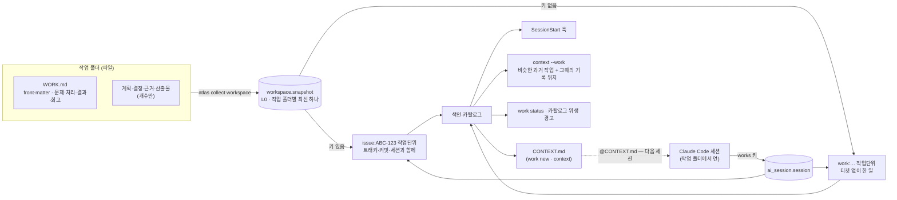

# 작업 공간 — 일 하나에 폴더 하나, 관리는 파일로

> Claude 와 일하는 작업 폴더를 어떻게 꾸리고, work-atlas 가 그것을 어떻게 읽고 돌려주는지 적는다.
> 용어는 [`CONCEPTS.md`](CONCEPTS.md#작업-공간), 데이터 계약은 `method/schema.md`, 템플릿은 `method/workspace/`.
> Claude Code 동작은 공식 문서로 확인한 것만 `[문서]`, 확인하지 못한 것은 `[미확인]`, 설계 판단은 `[추정]` 으로 적는다(2026-10-13 확인).

- [한 문단으로](#한-문단으로) · [왜 폴더가 아니라 파일인가](#왜-폴더가-아니라-파일인가)
- [파일의 역할](#파일의-역할) · [작업 기록 WORK.md](#작업-기록--workmd)
- [수명 — 만들고, 쓰고, 닫고, 남긴다](#수명--만들고-쓰고-닫고-남긴다)
- [루트와 배치](#루트와-배치) · [코드 저장소와 함께 쓰기](#코드-저장소와-함께-쓰기) · [Claude Code 설정](#claude-code-설정)
- [atlas 와의 연결](#atlas-와의-연결) · [개인정보와 보안](#개인정보와-보안) · [설정과 명령](#설정과-명령)
- [확인하지 않은 것 · 남겨 둔 시드](#확인하지-않은-것--남겨-둔-시드)

## 한 문단으로

이슈나 업무 하나마다 폴더를 만들고 그 안에서 Claude 세션을 연다고 하자. 그 폴더에는 그 일의 문제·시도·결정·결과가 사람의 말로 남는다. 트래커·커밋·대화 기록 어디에도 없는 것이다. work-atlas 는 이 폴더를 git·트래커·Claude Code 에 이은 **네 번째 관측원**으로 읽는다. 폴더의 **작업 기록**(`WORK.md`)을 같은 일의 이슈·커밋·세션과 한 **작업단위**(관측을 묶어 계산한 일 한 덩어리)로 묶고, 다음에 비슷한 일이 오면 그때의 기록이 어디 있는지 알려 준다. 관리의 단위는 폴더 트리가 아니라 **파일**이다. 폴더는 어디에 두든 자유이고, 일의 정체와 상태는 작업 기록 안에 적는다.

## 왜 폴더가 아니라 파일인가

1. **폴더 분류 체계는 사람마다 다르다.** 진행/완료/참고 같은 폴더 체계는 강요하면 지켜지지 않고, 지켜지지 않은 규칙은 데이터를 오염시킨다. 그래서 배치는 자유로 두고 규칙은 파일 안에 둔다.
2. **상태를 위치로 나타내면 세션이 끊긴다.**
   - Claude Code 는 세션을 시작 폴더에 묶어 `~/.claude/projects/<시작 폴더 경로>/` 아래 저장하고, `claude --continue` 는 현재 폴더의 가장 최근 세션을 연다 `[문서]`([sessions](https://code.claude.com/docs/en/sessions)).
   - 끝난 일을 `done/` 으로 옮기면 새 위치에서는 `--continue` 와 기본 세션 목록에 나오지 않는다. 세션 id 로 `--resume` 하거나, 목록을 모든 프로젝트로 넓혀(Ctrl+A) 찾아야 한다. 세션 이름으로 찾는 것은 현재 저장소 안만 본다 `[문서]`.
   - atlas 도 세션이 열린 폴더로 작업 폴더를 찾는다. 옮긴 뒤 수집하면 옛 세션이 그 작업에 붙지 않는다.
   - 그래서 상태는 `status` 한 줄로 적고 폴더는 옮기지 않는다.
3. **대화 기록은 사라지고 작업 기록은 남는다.** 대화 기록은 기본 30일 뒤 지워진다(`cleanupPeriodDays`) `[문서]`. AI 와 한 일의 결론을 오래 남기는 곳은 작업 기록이다.
4. **공통 규칙은 위에 한 번만 둔다.** Claude Code 는 시작 폴더와 그 위 모든 폴더의 CLAUDE.md 를 이어서 읽는다 `[문서]`([memory](https://code.claude.com/docs/en/memory)). 루트의 CLAUDE.md 는 모든 작업에 적용되고, 작업 폴더의 CLAUDE.md 에는 그 일에 관한 것만 둔다.
5. **기록이 세션에 저절로 들어가게 한다.**
   - CLAUDE.md 의 `@경로` 는 시작할 때 펼쳐 읽힌다. 상대 경로는 그 파일 기준이고, 네 단계까지 이어서 가져온다 `[문서]`.
   - 작업 폴더의 CLAUDE.md 는 `@WORK.md` 와 `@CONTEXT.md` 를 가져온다. `CONTEXT.md` 는 atlas 가 그 폴더에 만들어 두는 맥락 파일이다(비슷한 과거 작업·바꿀 가능성이 큰 파일·처리 통계). 그래서 세션을 열 때마다 최신 기록과 맥락으로 시작한다.
   - 압축(`/compact`) 뒤에는 프로젝트 루트의 CLAUDE.md 를 디스크에서 다시 읽어 넣는다 `[문서]`. 상위 폴더의 CLAUDE.md 와 `@` 로 가져온 파일도 다시 읽히는지는 문서에 없다 `[미확인]`. 그래서 압축 뒤에는 SessionStart 훅이 맥락을 다시 넣는다([Claude Code 설정](#claude-code-설정)).

## 파일의 역할

작업 폴더 기준 경로로 역할을 가른다. 대소문자는 가리지 않고, 먼저 맞는 규칙이 이긴다. 규칙은 `atlas/workspace.py` 의 `ROLES` 이고, 소스 설정 `roles` 로 역할별로 바꾼다.

| 역할 | 기본 이름 | 누가 · 언제 | 수명 | atlas 가 읽는 것 |
|---|---|---|---|---|
| **기록** | `WORK.md` | 사람과 Claude. 시작할 때 문제를, 끝날 때 결과·회고를 | 영구 — 일의 정본 | front-matter, 섹션별 채움 여부, 제목·문제·결과·회고·처리의 앞부분(발췌) |
| **지시** | `CLAUDE.md` · `CLAUDE.local.md` · `AGENTS.md` · `.claude/` | 시작할 때 | 일과 함께 | 개수 |
| **계획** | `PLAN*.md` · `SPEC*.md` · `plan/` · `design/` | 손대기 전 | 일과 함께 | 개수 |
| **결정** | `DECISION*.md` · `adr/` · `decisions/` | 갈림길마다(이유와 함께) | 영구 | 첫 결정 파일 본문의 앞부분(발췌) |
| **근거** | `evidence/` · `logs/` · `repro/` · `*.log` · `*.har` · 스크린샷 | 하면서 | 회사 보존 기한까지. 끝나면 줄인다 | 개수 |
| **산출물** | `out/` · `report*.md` · `handoff*.md` | 끝날 때 | 넘긴 곳이 정본이다 | 개수 |
| 그 밖 | 나머지 | | | 개수 |

관측하지 않는 것:
- 버릴 것: `scratch/` · `tmp/` 와 편집기 흔적.
- 도구 폴더: `node_modules` · `.venv` · `target` · `dist` · `.idea` 등. `dist/` 에 둔 산출물은 세지 않으니 `out/` 에 둔다.
- atlas 가 만든 `CONTEXT.md` · `WORK.draft.md`(LLM 작업 기록 초안 — `atlas llm run work_draft --write`): 첫 줄의 `<!-- atlas:generated` 표시로 알아본다. 요약을 다시 요약하지 않기 위해서다(CLAUDE.md 규칙 4). 표시가 없으면 사람의 파일로 센다. 초안은 사람이 읽고 고쳐 `WORK.md` 로 옮긴 뒤 지운다 — 옮긴 내용은 사람의 기록이라 관측된다.
- 작업 폴더 안의 저장소 사본(`.git` 이 있는 폴더): 개수만 센다.
- 비밀값으로 보이는 파일(`.env` · `*.pem` · `*.key` · `id_rsa*` · `*credentials*` …): 열지 않고 개수만 세어 경고로 올린다. 파일 이름으로만 가리므로 Keynote 의 `.key` 도 걸린다.

## 작업 기록 — WORK.md

템플릿은 `method/workspace/WORK.md` 이고, `atlas work new` 가 채워서 만든다.

```markdown
---
id: "ABC-123-session-drop"   # 작업 폴더의 정체 — 폴더 이름이 바뀌어도 그대로. 없으면 루트 기준 경로
key: ABC-123                  # 이슈 키. 비우면 폴더 이름에서 찾는다. 키가 없는 일도 된다
title: "로그인 직후 세션이 끊긴다"
status: active                # active · waiting · done · dropped
started: 2026-10-13
closed:
repos: [server]               # 이 일이 닿는 저장소 (atlas.toml 의 git 소스 이름)
---
# 로그인 직후 세션이 끊긴다
## 문제    무엇이 · 어디서 · 언제부터. 재현 방법과 영향
## 처리    접근과 시도 — 막힌 시도도 한 줄씩
## 결과    무엇을 바꿨고 어떻게 확인했나 · 남은 일
## 회고    다음에 비슷한 일을 받으면 먼저 볼 것
```

- 섹션은 `##` 머리말로 찾는다. 영문 머리말도 받는다(Problem · Approach · Result · Retro 등).
  - 머리말은 낱말 단위로 맞춘다. `## 결과 (2차)` 는 결과지만 `## 결과물` 은 아니다.
  - 같은 섹션이 여러 번 나오면 이어 붙인다.
- 안내 주석(`<!-- … -->`)만 있는 섹션은 빈 것으로 본다.
- front-matter 에서 읽는 필드는 `id` · `key`(또는 `keys`) · `title` · `status` · `started` · `closed` · `repos` · `kind` · `tags` 뿐이다.
  - 날짜는 적힌 문자열 그대로 둔다. `2026-02-30` 처럼 잘못된 날짜가 있어도 그 기록만 날짜 없이 읽고, 수집은 멈추지 않는다.
- **키는 설정이 인정하는 것만 쓴다**(`keys.projects` · `exclude_prefixes`). 인정하지 않는 키는 키가 없는 것으로 본다. `atlas work new` 는 그럴 때 알려 준다.
- **id 가 겹치면 경로로 가른다.** 폴더를 복사해 새 일을 시작하면 `id` 가 같아진다. 그 이름의 폴더 하나만 id 를 쓰고 나머지는 경로를 쓴다. `atlas work status` 가 알려 주니 복사한 쪽의 id 를 고친다.
- **회고**가 다음 일로 돌아가는 문단이다. 비슷한 일을 찾을 때 그 일의 문제·결과·회고가 검색 문서에 들어간다.

## 수명 — 만들고, 쓰고, 닫고, 남긴다

| 때 | 하는 일 | 명령 |
|---|---|---|
| 시작 | 작업 폴더를 만든다: 작업 기록 · 작업 CLAUDE.md · 맥락 파일. 그 폴더에서 `claude` 를 연다. 그 이슈가 수집·빌드돼 있으면 제목을 채운다 | `atlas work new ABC-123 --slug session-drop` · 키 없는 일은 `atlas work new cache-warmup` → `20261013-cache-warmup` |
| 진행 | 문제를 채우고 시도와 결정을 남긴다. 모델을 다시 빌드했으면 맥락 파일을 새로 만든다 | `atlas work context` |
| 끝 | 결과·회고를 채우고 상태를 닫는다. 결과·회고가 비었으면 알려 주고, 트리아지 예측을 남긴 일이면 판정 명령을 보여 준다 | `atlas work close` · 그만둔 일은 `--dropped` |
| 정리 | 오래 방치된 진행 중 작업, 결과 없이 끝난 작업, 트래커와 어긋난 상태, 정해지지 않은 상태 값, 겹친 id, 비밀값 파일을 본다 | `atlas work status` (끝난 작업까지 `--all`) |

- 끝난 일도 **폴더를 옮기지 않는다.** 상태만 바꾼다(앞 절 2번).
- **오래 방치된 작업**은 `active` · `waiting` 인데 `stale_work_days`(기본 30일) 넘게 손대지 않은 것이다. 끝났으면 닫고, 계속할 일이면 처리에 근황 한 줄을 남긴다.
- **근거 파일은 기한이 있다.** 로그·덤프는 회사 보존 정책에 맞춰 줄인다. 작업 기록과 결정 기록은 작고 값지니 남긴다.
- **다시 쓸 것은 승격한다.** 여러 일에서 쓸 스크립트·런북은 루트의 `_shared/` 로 옮기고, 원래 작업의 기록에 "옮김: _shared/…" 한 줄을 남긴다.

## 루트와 배치

```
~/work/                        작업 공간 루트 — atlas.toml [[sources.workspace]] root
├── CLAUDE.md                  모든 작업에 적용되는 규칙 (atlas work init — method/workspace/root.CLAUDE.md)
├── _shared/                   여러 일에서 다시 쓰는 파일 (`_`·`.` 로 시작하면 작업 폴더가 아니다)
├── ABC-123-session-drop/      작업 폴더 하나 = 일 하나
│   ├── WORK.md                작업 기록 — 정본
│   ├── CLAUDE.md              @WORK.md · @CONTEXT.md 를 가져온다 (method/workspace/work.CLAUDE.md)
│   ├── CONTEXT.md             atlas 가 만든 맥락 파일 — 고치지 않는다
│   ├── WORK.draft.md          (선택) LLM 이 쓴 작업 기록 초안 — 사람이 WORK.md 로 옮기고 지운다
│   ├── PLAN.md  DECISIONS.md  evidence/  out/  scratch/
└── 20261013-cache-warmup/     키 없는 일도 같은 모양
```

- **무엇이 작업 폴더인가** — 수집기와 세션 연결(`locate`)이 같은 규칙을 쓴다:
  - 작업 기록(`WORK.md`)이 있는 폴더. 루트에서 여섯 단계까지 찾는다.
  - 또는 깊이 `depth`(기본 1)의 폴더. 기록이 없어도 작업 폴더다 — "폴더 하나가 일 하나"라는 관례를 따른다.
  - `_` · `.` 로 시작하는 폴더와 도구 폴더는 아니다. 기록이 없는 저장소 사본도 아니다.
  - 안에 작업 폴더를 품은 폴더는 묶음이다. 예: `archive/2025/ABC-1/` 의 `archive`.
  - 작업 폴더 안으로는 더 내려가지 않는다. 안쪽에 또 `WORK.md` 가 있어도 바깥이 작업 폴더다.
- **워크트리를 작업 폴더로 써도 된다.** `git worktree` 로 만든 폴더에 `WORK.md` 를 두면 작업 폴더다. 맨 위 파일과 역할 폴더(`evidence/` · `out/` · `plan/` 등)만 센다. 코드 파일은 작업 파일로 세지 않는다.
- 팀이나 분기로 한 단계 묶어 쓴다면 `depth = 2`.
- 폴더 이름은 `ABC-123-짧은-설명` 또는 `YYYYMMDD-짧은-설명` 을 권한다. 폴더 이름의 키는 기록에 키를 적지 않았을 때만 쓴다.

## 코드 저장소와 함께 쓰기

| 어디서 시작하나 | 쓰는 법 | atlas 에서 |
|---|---|---|
| **작업 폴더** (조사·여러 저장소·운영 대응) | `claude --add-dir ~/src/server` 로 시작하면 더한 저장소의 파일을 읽고 고칠 수 있다. 그 저장소의 CLAUDE.md 는 `CLAUDE_CODE_ADDITIONAL_DIRECTORIES_CLAUDE_MD=1` 일 때만 읽는다. 설정 `additionalDirectories` 로 더한 폴더는 CLAUDE.md 를 읽지 않는다 `[문서]`([large-codebases](https://code.claude.com/docs/en/large-codebases)). `--add-dir` 은 `--resume` 때 다시 줘야 한다 `[문서]` | 세션이 그 작업 폴더의 작업단위에 붙는다. 저장소 파일 편집은 그 저장소 기준 경로로 남는다. 키 없는 작업이면 그 경로로 같은 시간대의 커밋을 찾아 잇는다. 작업 공간 안의 파일 편집(기록·근거)은 코드 경로로 세지 않는다(`work_edits`). 작업 폴더 안에 받아 둔 저장소 사본의 파일은 코드다 |
| **저장소** (한 저장소의 개발) | 이슈 브랜치에서 연다. 작업 기록은 따로 열어 두거나 저장소 밖 파일을 `@` 로 가져온다. 시작 폴더 밖을 가리키는 가져오기는 프로젝트마다 한 번 승인 창이 뜨고, 거절하면 꺼진 채 다시 묻지 않는다 `[문서]` | 이슈 키(브랜치·프롬프트)로 같은 작업단위에 붙는다. **키 없는 일은 이 방식으로는 그 작업 폴더에 붙지 않는다** — 작업 폴더에서 시작한다 |

키 있는 일은 어느 쪽에서 시작해도 같은 작업단위로 묶인다. 조사·대응이 섞인 일이나 키 없는 일은 작업 폴더에서 시작한다.

## Claude Code 설정

- **훅은 사용자 설정에 둔다.**
  - `atlas hook --print-settings` 가 낸 것을 `~/.claude/settings.json` 에 합친다. 사용자 설정은 모든 프로젝트에 적용된다 `[문서]`([hooks](https://code.claude.com/docs/en/hooks)).
  - 프로젝트 설정(`.claude/settings.json`)은 CLAUDE.md 와 달리 상위 폴더에서 이어받지 않는다 `[문서]`([large-codebases](https://code.claude.com/docs/en/large-codebases)). 루트에 둔 프로젝트 설정은 작업 폴더에서 읽히지 않는다.
- **SessionStart 훅이 작업 폴더의 맥락을 넣는다.**
  - SessionStart 는 시작 방식(`startup` · `resume` · `clear` · `compact` · `fork`)을 알려 주고, 입력에 `cwd` 가 있다 `[문서]`. atlas 는 시작·`/clear`·압축 뒤에 맥락을 넣는다.
  - 작업 CLAUDE.md 가 `@CONTEXT.md` 를 가져오고 그 파일이 지금 세대로 만든 것이면, 시작·`/clear` 때는 넣지 않는다. 같은 맥락을 두 번 넣지 않기 위해서다.
  - 압축 뒤에는 늘 넣는다. 맥락 파일이 낡았으면(만든 세대가 다르면) 지금 맥락을 넣고 그 사실을 알린다.
  - 훅 출력 상한은 1만 자다 `[문서]`. atlas 는 1,500자 안팎으로 자른다.
- **훅이 막혀 있어도 동작한다.** 관리자는 `allowManagedHooksOnly` 로 사용자 훅을 막을 수 있다 `[문서]`. 그래도 `@CONTEXT.md` 가져오기는 파일이라 동작한다. 파일 경로를 먼저 둔 이유다.
- **자동 메모리**는 git 저장소 단위로 묶이고, 저장소 밖이면 "프로젝트 루트" 단위다 `[문서]`. 작업 공간 루트가 git 저장소면 모든 작업 폴더가 자동 메모리 하나를 같이 쓴다. 아니면 작업 폴더마다 따로 쓸 것이다 `[추정]` — 문서가 저장소 밖의 프로젝트 루트를 정의하지 않는다.

## atlas 와의 연결



| 무엇 | 규칙 |
|---|---|
| 작업단위 연결 | 기록의 키(없으면 폴더 이름의 키) → 그 이슈 작업단위. 키가 여럿이면 각 이슈에 든다. 키가 없으면 `work:<소스 이름>:<id>` 작업단위다. 작업 폴더에서 연 세션은 그 폴더가 속한 작업단위에 붙는다(`work_folder`). 프롬프트의 키 연결도 그대로 남는다(다대다) |
| 기간·상태 | 트래커가 있으면 트래커가 정본이다. 트래커가 없을 때만 상태를 적은 작업 기록을 따른다(`end_basis: work`). 시작은 `started`, 끝은 `done`·`dropped` 일 때의 `closed` 다(그 스냅숏 시각을 넘지 않는다). `dropped` 는 중단(abandoned)이다. 상태를 적지 않은 폴더는 다른 작업단위처럼 마지막 활동을 끝으로 잡는다 |
| 비슷한 과거 작업 | 검색 문서는 이슈 요약 → 작업 기록 → 커밋·프롬프트 순이다. 결과에 그때의 작업 기록 위치를 붙인다. 지금 작업 폴더 자신(모든 키)은 결과에서 뺀다 |
| 위생 경고 | 카탈로그 `works` 와 경고(`area: workspace`): 결과 없이 끝남 · 오래 방치 · 트래커와 어긋남 · 정해지지 않은 상태 · 비밀값 파일. 어느 폴더인지와 기록 없음·front-matter 오류·겹친 id 는 `atlas work status` 가 보여 준다. 지식의 신뢰도가 아니라 정리 문제라서 맥락 첫 줄에는 넣지 않는다 |

## 개인정보와 보안

- **내용을 읽는 파일은 둘이다.** 작업 기록과 첫 결정 기록이다. 비밀값·연락처 형식을 가린 뒤 앞부분만 자른다(`excerpt_chars` 기본 1,500, `excerpt = false` 로 끈다). 나머지 파일은 이름으로 역할만 센다.
- **가림은 안전망이다.** 작업 기록에 동료 이름이나 고객 데이터를 적으면 발췌에 들어간다. 토큰·키·연락처 형식과 홈 폴더 경로의 계정 이름(`/Users/<계정>` → `~`)은 가리지만, 본문의 사람 이름은 기계적으로 가릴 수 없다. 작업 기록에는 사람을 역할로 적는다(METHODOLOGY.md §11).
- **경로는 루트 기준으로만 남긴다.** 루트 자체(홈 폴더·계정 이름이 든 경로)는 관측에 넣지 않는다. front-matter 값에 절대 경로가 있으면 마지막 이름만 남긴다(`repos: [/Users/kim/src/api]` → `api`). 화면에 보이는 절대 경로는 이 컴퓨터의 설정으로 그때 붙인다.
- **작업 폴더에 쓰는 것은 `atlas work new · context · close` 뿐이다.** 사람이 부르거나 그 작업을 하는 Claude 가 부를 때만 쓴다. 쓰는 것은 새 작업의 파일, 맥락 파일, front-matter 두 줄이다. 수집·빌드·주간 수확은 읽기만 한다(CLAUDE.md 규칙 9).
- **기존 파일을 깨뜨리지 않는다.** close 는 UTF-8 이 아닌 기록을 고치지 않고, 줄마다의 줄바꿈(CRLF·LF)·BOM·주석을 그대로 둔다. 같은 키가 여러 줄이면 모두 바꾼다.

## 설정과 명령

```toml
[[sources.workspace]]
name = "ws"                # 작업 id 앞에 붙는다(ws:<id> · wu:work:ws:<id>, 세션의 works 키). 바꾸면 지난 관측과 이어지지 않는다
root = "/path/to/work"     # 절대 경로, 또는 인스턴스 루트 기준 상대 경로
# depth = 1 · record = "WORK.md" · excerpt = true · excerpt_chars = 1500 · max_files = 5000
# [sources.workspace.roles]  evidence = ["evidence/**", "**/*.log"]

[policy]
stale_work_days = 30       # 진행 중인 작업 폴더가 이보다 오래 손대지 않았으면 정리 제안
```

| 명령 | 하는 일 |
|---|---|
| `atlas work init` | 루트에 공통 규칙(CLAUDE.md)을 둔다. 이미 있으면 건드리지 않고 합칠 내용을 보여 준다 |
| `atlas work new <키 \| 짧은-이름> [--slug …] [--title …]` | 작업 폴더를 만든다. 그 이슈가 수집·빌드돼 있으면 제목을 채운다 |
| `atlas work context [경로]` | 그 작업 폴더의 맥락 파일을 지금 모델로 다시 만든다 |
| `atlas work close [경로] [--dropped]` | `status` · `closed` 를 적는다. 비어 있는 결과·회고와 남길 판정을 알린다 |
| `atlas work status [--all] [--json]` | 작업 폴더 목록과 위생 표시 |
| `atlas collect workspace` | 작업 폴더를 관측한다. 주간 수확의 `collect all` 에 포함된다 |
| `atlas context --work [경로]` | 그 작업 폴더의 키·제목·문제로 맥락을 낸다 |

작업 폴더에서 명령을 부르면 인스턴스는 `--root` → `ATLAS_HOME` → 현재 폴더 위 → 설치된 패키지의 저장소 순으로 찾는다. 사용 스킬처럼 `ATLAS_HOME` 을 정해 두면 어디서 부르든 같은 인스턴스를 쓴다.

## 확인하지 않은 것 · 남겨 둔 시드

- **효용은 아직 재지 않았다.** 공개 평가 데이터(LANG·ZK)에는 작업 폴더가 없다. 연결과 동작은 테스트로 검증했다. 작업 기록이 비슷한 작업 찾기를 낫게 하는지는 사내에서 `atlas eval` 로 잰다. 작업 기록 텍스트를 넣은 것과 뺀 것을 비교하는 옵션은 아직 없다(시드).
- **작업 공간 수집을 켜기 전에 수집한 세션은 작업 폴더에 붙지 않는다.** 관측은 고치지 않고, 같은 세션은 다시 들어가지 않는다. 켠 뒤에 수집한 세션부터 붙는다.
- **대화 기록의 형식은 Claude Code 내부 형식이고 버전마다 바뀐다** `[문서]`. 세션의 시작 폴더(`cwd`)를 읽는 부분도 그렇다. 훅 입력의 `cwd` 는 문서화돼 있다 `[문서]`.
- **폴더를 옮긴 뒤 수집한 옛 세션은 작업 폴더를 찾지 못한다.** 그 세션이 열린 경로가 사라졌기 때문이다.
- **`@` 로 가져온 파일과 상위 폴더의 CLAUDE.md 가 압축 뒤 다시 읽히는지** `[미확인]` — SessionStart 훅이 메운다.
- **시드**:
  - 실천과 결과 — 손대기 전에 계획을 썼나, 결정을 남겼나, 결과를 적었나와 재오픈의 연관. 사내 데이터가 쌓인 뒤 `practice` 마이너에 더하고 평가로 채택한다.
  - Stop 훅 — 세션 끝에 결과·회고가 비어 있으면 상기시킨다.
  - 여러 작업 폴더에 같은 스크립트가 있을 때 `_shared/` 로 승격할 후보를 알린다.
  - 작업 기록 품질 지표 — 채움 비율, 회고 길이.
